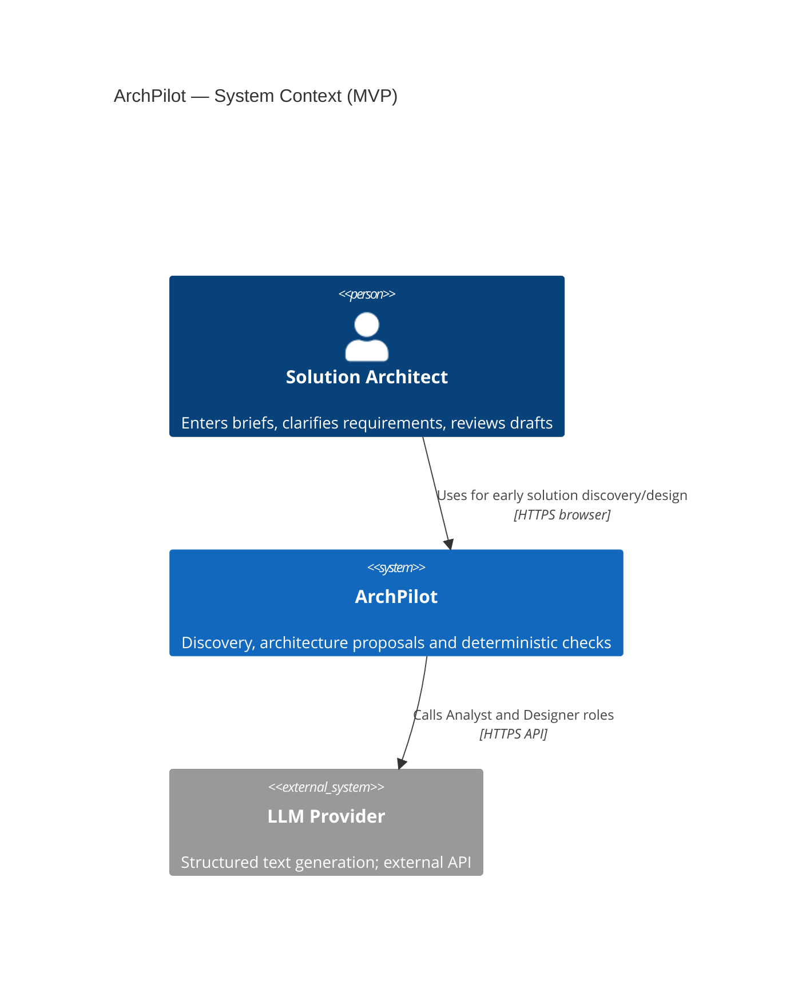
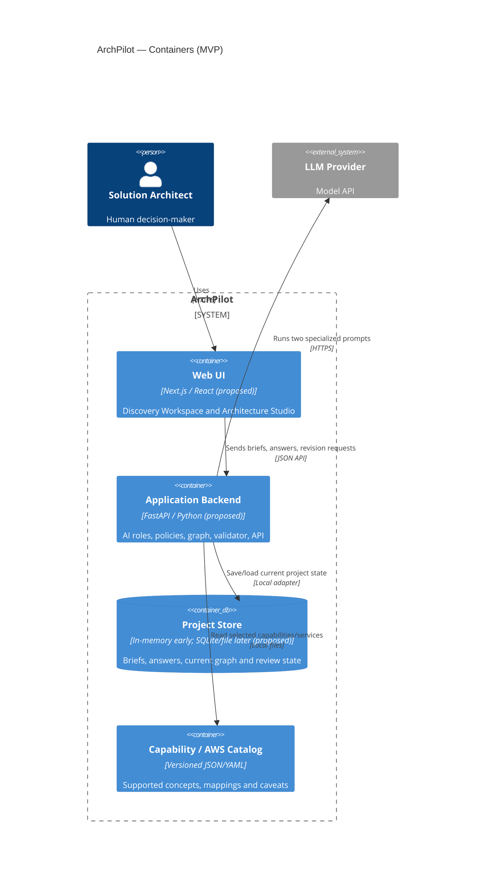
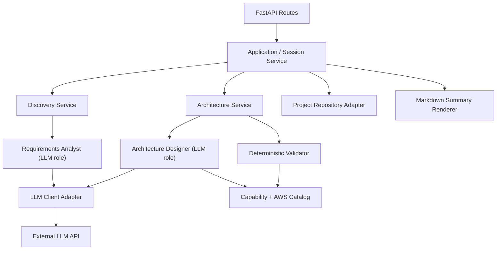
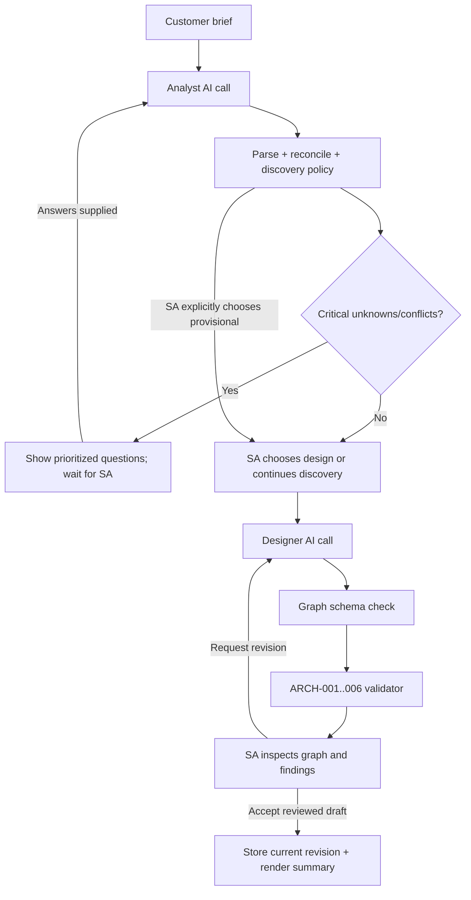
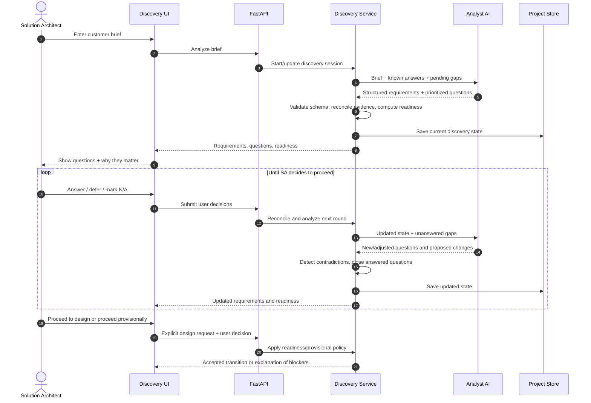
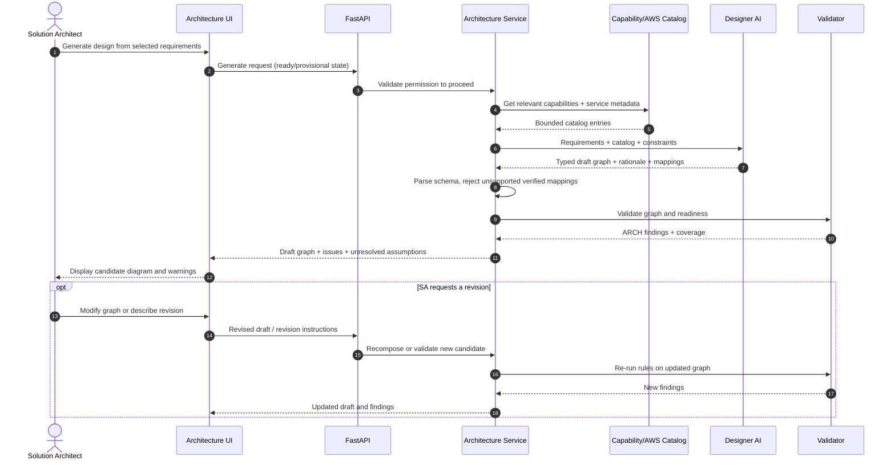
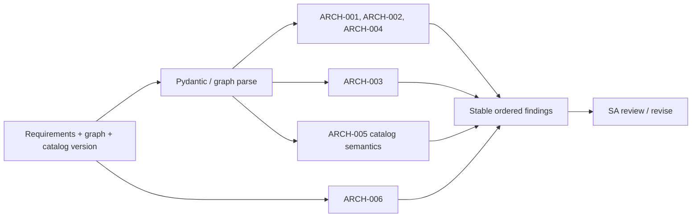
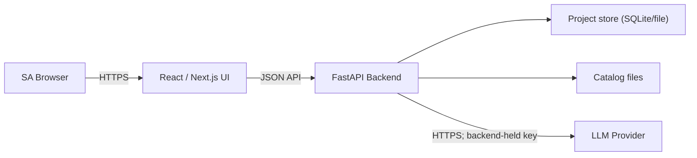

# ArchPilot — System Architecture Design (High-Level Design)

| Field | Value |
|---|---|
| Document ID | ARCHPILOT-HLD-002 |
| Version | **1.1 — Simplified four-month MVP** |
| Date | 11 November 2026 |
| Status | **MVP architecture proposed, consistent with agreed v1.1 PRD; detailed decisions need owner approval** |
| Primary source | `01-PRD.md` v1.1 |
| Audience | Project owner / AI Solutions Architect, CodeBuddy, Codex, technical reviewers |
| Supersedes | HLD v1.0 on MVP responsibilities, agent count, release gates and technology timing |

> **Read this first:** This HLD defines the **smallest coherent system** that delivers the agreed ArchPilot MVP. It is not a mandate to implement all future ideas. If this HLD and the legacy `ArchPilot_CodeBuddy_Development_Blueprint_v1.1.md` conflict, follow **PRD + HLD v1.1**. Exact field names and endpoint payloads are **not frozen** until `03-DATA-CONTRACTS.md`. Planned technologies are proposals, not blanket installation instructions.

## 0. Executive architecture summary

ArchPilot is a **single-user, web-based solution-design assistant** with three primary workflows:

1. **Consultative discovery:** Analyze the customer's brief; maintain known facts, assumptions, contradictions and unanswered questions; propose prioritized follow-up questions; support multi-round SA input and explicit provisional decisions.
2. **Architecture generation:** A dedicated Designer AI role converts the selected requirements into a **provider-neutral node/edge graph**, with optional AWS mappings drawn from a small curated catalog. The design is a *proposal*, never a certified implementation.
3. **Validation and review:** Deterministic Python rules return reproducible findings; the SA reviews the diagram and issues, changes/revises the design, and may accept a **specific draft revision**. Simple Markdown export and evaluation complete the MVP.

The target design is a **modular monolith**: one web frontend, one FastAPI backend, one LLM provider integration, local catalog data, and basic project storage. There are **two AI roles**, not five independently running agents. Plain Python services coordinate them; there is **no independent Cloud Specialist, Architecture Reviewer, or Documentation Agent** in the first release.

### 0.1 Decision status

| Area | Status | MVP design |
|---|---|---|
| Discovery-first workflow | **Agreed** | SA must see gaps and questions before or alongside a provisional design. |
| AI roles | **Agreed** | Requirements Analyst + Architecture Designer. |
| Validator | **Agreed** | Dedicated deterministic engine, separate from model opinions. |
| Architecture representation | **Agreed** | Structured logical graph plus requirements traceability. |
| AWS scope | **Agreed direction** | Small, curated AWS catalog; access as Designer tool/data, not standalone agent. |
| Backend | **Proposed** | Python + FastAPI + Pydantic in one application. |
| Frontend | **Proposed** | Next.js/React; React Flow for graph display and basic edits. |
| Coordination | **Proposed** | Plain Python functions with explicit state and bounded calls; no LangGraph dependency. |
| Persistence | **Proposed** | In-memory during early tests; SQLite or simple file-based store by Month 3. |
| Deployment | **Open** | One low-cost environment with HTTPS and protected keys; choose after testing. |
| Complex approvals, reviewer/doc agents, impact engine, full audit ledger | **Deferred** | Documented future architecture only; do not implement now. |

### 0.2 Quality and scope principles

- **Make unknowns visible.** Missing budget or residency cannot be invented by the LLM.
- **Treat AI outputs as candidates.** Parse and validate before use; human decides.
- **Separate logical design from cloud-specific service choice.** A capability is not the same thing as a provider SKU.
- **Validate what is provable.** `ARCH-001`–`ARCH-006` are narrow checks, not a Well-Architected or compliance certificate.
- **Build vertical slices.** Show useful discovery functionality in Month 1; do not wait for an enterprise-grade workflow engine.
- **Defer until justified.** Extra agents, detailed version history, cost engines and distributed infrastructure must earn their complexity.

---

## 1. Architecture drivers, scope and interfaces

### 1.1 Product drivers (PRD traceability)

| Driver | PRD IDs | Architecture response |
|---|---|---|
| Adaptive questions, answer continuity and contradictions | FR-002–007 | Analyst role + discovery state and policy functions |
| Provider-neutral designs from unfamiliar briefs | FR-009–010 | Designer role + capability vocabulary + typed graph |
| Cloud recommendations grounded in known components | FR-011 | Small version-controlled AWS catalog read by Designer |
| Reproducible checks independent of LLM | FR-013 | Pure Python rule engine with stable rule IDs |
| SA can inspect/revise draft | FR-016–018 | Browser review, mutation/revision API, revalidation |
| Minimum project continuity | FR-008, FR-020 | Lightweight project repository; no immutable event ledger |
| Evidence that product improves an LLM workflow | FR-024 | Evaluator using synthetic briefs, baseline, and human rubric |

### 1.2 Deliberate architectural exclusions

No Kubernetes, event bus, vector database, background workers, microservices, unrestricted browsing, shell-executing agents, multi-cloud pricing optimizer or automatic provisioning. No need to create folders for future components before those modules exist.

### 1.3 Trust boundary

Customer-supplied text is untrusted. A brief may contain instructions such as “ignore validation rules”; it must be interpreted as **customer data**, not as privileged instructions. Catalog content is curated but still treated as reference data. The backend alone owns keys, validation, policy, and the authoritative project state. The browser is an untrusted client.

---

## 2. C4 architecture views

C4 views describe **the ArchPilot application**, not the customer architecture that ArchPilot generates. Mermaid diagrams below are intended for repository documentation; rendering compatibility should be checked in the chosen Markdown viewer.

### 2.1 C4 Level 1 — System context



**Boundary note:** The demo SA, not ArchPilot, remains responsible for verifying factual assumptions and accepting/rejecting designs. No customer cloud credentials are required.

### 2.2 C4 Level 2 — Containers



**One backend process** is enough. A second agent means a second *role/invocation*, not a separately deployed service. In-memory state is acceptable for tests and the first demonstration only; use durable storage when save/reload is promised.

### 2.3 C4 Level 3 — Backend component responsibilities



**Responsibility split:** Discovery policy handles statuses/contradictions/readiness; Analyst proposes content. Architecture service accepts/rejects candidate graph; Designer composes it. Validator never calls the model. The export renderer builds Markdown from validated stored artifacts; no Documentation Agent.

---

## 3. Components and module ownership

| Component | Main responsibility | Does not own |
|---|---|---|
| `api` | HTTP input/output, request validation, response codes | Product reasoning or approval decisions |
| `project_service` | Retrieve/update a project and current artifacts; explicit user actions | Model generation |
| `discovery_service` | Run Analyst; reconcile answers; deduplicate questions; compute readiness | Architectural topology |
| `requirements_analyst` | Generate typed extraction, prioritized questions, conflict suggestions | Overwriting confirmed facts / marking approved |
| `architecture_service` | Assemble selected inputs; run Designer; coordinate validation/revision | Actual cloud provisioning |
| `architecture_designer` | Generate logical graph, component rationale, catalog suggestions | Declaring a mapping verified if catalog does not support it |
| `capability_catalog` | Known logical capabilities and limited curated AWS metadata | Complete/current cloud inventory or pricing |
| `validation_engine` | `ARCH-001`–`006` checks and reproducible findings | Subjective certification or AI-based scoring |
| `project_repository` | Basic save/reload; session/project IDs | Rich immutable version/event histories |
| `summary_renderer` | Render Markdown from current artifacts and findings | Independent AI documentation generation |
| `web_ui` | Manage customer brief, Q&A, graph view and review actions | Trusted server rules or secrets |

### 3.1 Proposed backend directory structure

```text
archpilot/
  backend/
    app/
      main.py
      api/                 # health, discovery, architecture, projects
      models/              # Pydantic contracts shared by routes/services
      services/            # discovery, architecture, project, export
      agents/              # requirements_analyst.py, architecture_designer.py
      rules/               # arch_001_006.py
      catalog/             # capability and AWS metadata readers
      adapters/            # llm client and storage implementations
    tests/                 # fixtures, unit, integration, mocked LLM tests
  frontend/                # build thin discovery UI first, architecture UI later
  catalog/                 # version-controlled capability/AWS metadata
  examples/synthetic-briefs/
  docs/                    # PRD/HLD/contracts/evaluation/ADRs
  README.md
```

Create only the directories needed in the active sprint. Domain validation should be importable/testable without FastAPI, network access or an LLM API key.

### 3.2 Dependency guidelines

- HTTP/API routes call **services**, not LLM SDK methods directly.
- Agent adapters return **typed candidate objects**, not side-effectful DB writes.
- Services own reconciliation and state transitions; models may propose questions/designs but cannot approve anything.
- Validator takes explicit requirements + graph (+ catalog semantics) and returns findings without network calls.
- Catalog files are version-controlled and readable offline.
- Storage technology is isolated behind a small repository interface so in-memory tests can graduate to durable storage without rewriting agents.

---

## 4. Two-agent workflow and explicit handoffs

### 4.1 Role descriptions

**Requirements Analyst (AI role)**

- **Input:** Original brief, confirmed statements, answered/unanswered questions, relevant source snippets and question statuses.
- **Output:** Candidate structured requirements; suggested missing questions with priority, rationale and affected decisions; possible contradictions; concise discovery summary.
- **Rules:** Treat customer answers as evidence; no invented confirmed values; do not issue an approval event; do not silently overwrite prior confirmed answers.

**Architecture Designer (AI role)**

- **Input:** The selected requirements summary with its `ready/provisional` decision, supported capability vocabulary, relevant AWS catalog entries, and optional prior findings.
- **Output:** Candidate logical `ArchitectureGraph`; purpose/requirement linkage per major component; optional grounded AWS mapping suggestions and unresolved concerns.
- **Rules:** No service outside catalog marked as verified; design does not automatically pass validation; no infrastructure provisioning.

### 4.2 Coordination: plain Python, not a third AI



This is a **simple stateful sequence of functions and human actions**. A framework such as LangGraph is not justified for the initial design; reconsider only if actual checkpointing/branching needs exceed this approach.

### 4.3 Runtime boundaries

- Set model timeout, token limits, and a small maximum number of invalid-output retries. Defaults are **proposals** and will be defined in `03-DATA-CONTRACTS.md` / configuration.
- Automatic repairs are bounded. Exhausting them produces an explicit `generation_failed`/`needs_review` response with preserved previous artifacts, not an infinite loop.
- Do not use free-running agent-to-agent conversation or grant LLM roles arbitrary filesystem, shell, browser or cloud-modification access.
- Log model role, stage, elapsed time, outcome, and a correlation ID; never log credentials or raw private data.
- Both roles may use the same underlying LLM; compare against a single-agent baseline later.

---

## 5. Consultative requirements discovery (first-class feature)

### 5.1 State concepts

The system must distinguish **requirement evidence** from **question status** and from **project readiness**.

- A statement is `confirmed`, `assumed`, `unknown`, or `contradicted` depending on its evidence and user action.
- A question may be `open`, `answered`, `deferred` or `not_applicable`. (Whether a separate `unknown` question status is needed is a data-contract decision.)
- Discovery readiness is `needs_clarification`, `ready_for_design`, or `provisional` — **not** an LLM numeric confidence score.
- The SA chooses whether to continue or proceed. `provisional` is a deliberate user decision with visible open issues.

**Do not automatically erase a contradictory answer.** Both incompatible claims must be retained or visible for resolution, even if advanced immutable audit/history is deferred.

### 5.2 Discovery sequence diagram



### 5.3 Discovery rules and failure behavior

1. Extract **only what is supported** by brief/answers as confirmed. Missing budget, availability targets or region remain missing.
2. Ask high-impact clarifications with **why this matters** and a link to a relevant design choice. Suggest roughly 3–5 questions/round to avoid a long questionnaire.
3. After an answer, update the structured state; do not simply append chat text. Suppress semantically resolved questions unless a new contradiction makes them relevant.
4. On contradictory evidence, show both claims and require SA resolution or explicitly documented exception.
5. On unavailable LLM, display prior questions/answers and a retry action; never mark readiness approved just because generation failed.
6. On a critical unresolved issue, show `needs_clarification` by default; a user may choose `provisional`, which is visibly carried into the graph/summary.

### 5.4 Minimum discovery acceptance scenarios (PRD FR-003–007)

- **Customer support:** 10,000 conversations/day, bilingual, document-backed, sensitive data, limited budget → questions on actual budget, geographic processing, peak usage and action permissions.
- **EU contradiction:** EU-only requirement + US-only inference proposal → flagged conflict, both claims retained, never silently accepted.
- **Three rounds:** answers from the first round remain present and do not trigger repetitive questions on later rounds.

---

## 6. Architecture generation and grounded service suggestions

### 6.1 Two-level architectural representation

**Logical graph (primary):** Nodes describe capabilities such as `api_backend`, `object_storage`, `queue`, `processing_worker`, `llm_inference`, `semantic_retrieval`, `relational_storage`, `identity`, and `observability`. Edges describe typed relationships such as `request`, `data_flow`, `event`, or `dependency`. Nodes refer to originating requirement IDs or an explicit cross-cutting rationale.

**Cloud service mapping (optional annotation):** An eligible logical node may suggest one AWS service from a **supported small catalog**. Mappings have rationale, catalog ID and caveats; unsupported capabilities remain logical nodes with `mapping_status=unknown` instead of being silently discarded.

A component **catalog** is not a catalog of finished use cases. The Designer should be able to combine supported logical nodes differently for customer support, document extraction, and other bounded cloud-native workloads.

### 6.2 Proposed minimal capability/AWS catalog

Start with **10–15** version-controlled entries, for example: API Gateway, Lambda, ECS/Fargate, S3, SQS, RDS, DynamoDB, Bedrock, CloudWatch, IAM, Secrets Manager, EventBridge, CloudFront, Step Functions, and a supported retrieval option. This is a **candidate shortlist**, not an assertion that every entry is needed or available in every AWS region.

Each entry should contain: canonical ID, service name, capabilities, expected inputs/outputs, key limitations, relevant dependency or compatibility annotations, evidence/source URL, last-reviewed date, and optionally region caveats. Use official documentation when verifying the actual entries during implementation. Do not invent exact prices or unrestricted geographic availability.

### 6.3 Architecture generation sequence diagram



### 6.4 Generation algorithm (conceptual; not prescribed implementation code)

1. Get the **selected current requirements** and provisional warnings.
2. Retrieve only relevant entries from the supported capability/service vocabulary.
3. Ask Designer for a **structured candidate graph** and rationales.
4. Parse the graph strictly. Invalid objects are not stored as accepted designs; optionally retry a limited number of times with error feedback.
5. Run deterministic validation; present the graph and findings to SA.
6. On revision, produce a new **draft revision** and re-run validation. If the model remains unsuccessful, preserve the last usable draft and surface failure.

The LLM can suggest topology; code must check structural referential integrity. Architecture suitability remains a human review question.

---

## 7. Deterministic validation engine

### 7.1 Contract boundary

**Input:** A selected requirements state, architecture graph, named catalog semantics, and rule/catalog version. **Output:** Ordered `ValidationFinding[]` with stable `rule_id`, affected IDs, severity, description and suggested remediation. The exact Pydantic object shape will be defined in `03-DATA-CONTRACTS.md`.

The validator is a **pure function** or a group of pure functions. It must not invoke any LLM or use uncontrolled Internet data. The same normalized inputs and rule/catalog versions must yield identical findings.

### 7.2 Named checks — exact alignment with PRD

| Rule | Check | Handling |
|---|---|---|
| **ARCH-001** | Duplicate node IDs within node list or edge IDs within edge list | Structural error |
| **ARCH-002** | Edge has source/target not present in node set | Structural error |
| **ARCH-003** | Must-have capability declared in requirements missing from graph | Coverage error; avoid overclaiming real requirement satisfaction |
| **ARCH-004** | Node references nonexistent requirement ID | Traceability error |
| **ARCH-005** | Known queue requires a connected consumer/worker but none exists | Warning where metadata is inconclusive; stronger only with explicit semantics |
| **ARCH-006** | Critical unresolved or contradicted input, or unaccepted assumption | Readiness finding; **does not inherently invalidate graph topology** |

**Important:** `schema_valid`, `graph_rules_passed`, and `readiness_blockers` are separate output dimensions. Do not collapse them into a single “safe / unsafe” or “production-ready” badge.

### 7.3 Example validation flow



### 7.4 Testing guidelines

- Seed at least one positive and one negative fixture for each named rule.
- Test mixed conditions, e.g., correct topology with unresolved critical residency question (readiness warning but graph may be structurally valid).
- Test graph revisions and revalidation; malformed or missing IDs must be rejected.
- Test a queue with **known** and **unknown** metadata; avoid interpreting catalog uncertainty as a proven architectural defect.
- Keep catalog/rules versions explicit in test fixtures to preserve reproducibility.

---

## 8. API boundaries and example operations

The routes below are **proposed**, not final contracts. Exact request fields, status codes, idempotency and error bodies belong in `03-DATA-CONTRACTS.md`. Implement only those necessary for the active month.

| Operation | Proposed endpoint | First needed |
|---|---|---|
| Health check | `GET /health` | Foundation, Month 1 |
| Start project | `POST /api/projects` | Month 1 |
| Analyze/re-analyze discovery | `POST /api/projects/{id}/discovery/analyze` | Month 1 |
| Submit answers and question decisions | `POST /api/projects/{id}/discovery/answers` | Month 1 |
| Read current discovery state | `GET /api/projects/{id}/discovery` | Month 1 |
| Request draft architecture | `POST /api/projects/{id}/architectures/generate` | Month 2 |
| Validate a graph (stateless) | `POST /api/architectures/validate` | Month 2–3 |
| Read/update current draft | `GET /api/projects/{id}/architecture` / `PATCH /api/projects/{id}/architecture` | Month 3 |
| Submit SA review/accept decision | `POST /api/projects/{id}/architecture/review` | Month 3 |
| Export a Markdown summary | `GET /api/projects/{id}/summary.md` | Month 4 |

**Error conventions:** Validation problems return stable codes with an actionable message and affected field/artifact IDs. Model timeouts, invalid structured generation, unknown project IDs and user-policy blockers must be distinguishable. The frontend must not accept model-supplied `approved` flags or trust client-supplied rule results.

### 8.1 Runtime state machine (minimal)

```mermaid
stateDiagram-v2
    [*] --> BriefCreated
    BriefCreated --> Discovering: Analyze
    Discovering --> Discovering: Answer / clarify
    Discovering --> ReadyToDesign: SA chooses proceed; constraints acceptable
    Discovering --> Provisional: SA explicitly proceeds with open issues
    ReadyToDesign --> DraftDesign: Generate
    Provisional --> DraftDesign: Generate with warnings
    DraftDesign --> DraftDesign: Revise / revalidate
    DraftDesign --> Reviewed: SA accepts draft revision
    DraftDesign --> Discovering: New important question
    Reviewed --> DraftDesign: New change invalidates previous review
```



These states are a **workflow illustration**. Persist a small number of fields rather than implementing a generic enterprise state-machine platform. The UI should show the current stage and the reason it cannot proceed.

---

## 9. Data ownership, storage and change handling

### 9.1 Minimal canonical artifacts

- `Project`: stable ID, title, original brief, current stage.
- `Requirement`: ID, text, type, evidence/status, optional capability tags.
- `ClarificationQuestion`: ID, question, priority, rationale, status, associated requirement/decision.
- `DiscoveryState`: current requirements/questions, known answers/conflicts, readiness decision.
- `ArchitectureGraph`: graph ID/revision, typed nodes and edges, rationales, requirement links, provisional markers.
- `ValidationFinding`: rule ID, affected elements, severity, evidence and remediation.
- `ReviewDecision`: explicit SA action on a selected graph revision.

All types above are **conceptual** until formalized in `03-DATA-CONTRACTS.md`. Avoid a complex generic event schema, immutable snapshot store, or graph database at this point.

### 9.2 Persistence evolution

- **Month 1:** In-memory storage is sufficient for unit/API tests. If a browser demo needs session continuity across restarts, add a **minimal file/SQLite adapter** rather than introducing a complex DB service.
- **Months 2–3:** Persist a current project state and current architecture revision; ensure users can close/reopen the demo project. SQLite is a reasonable proposed local choice, with an interface that can be replaced later.
- **Month 4:** Deploy with backup/reset strategy appropriate for **synthetic demo data only**. Do not claim enterprise data retention or isolation.

**Revision handling:** Each accepted graph must have an ID/revision or content hash so the SA knows what they reviewed. When edited, a draft becomes `needs_review` and validation runs again. This is **not** the full immutable version history or automatic dependency impact engine proposed in HLD v1.0; those remain deferred.

---

## 10. Security, privacy and reliability

### 10.1 Security controls (scaled to MVP)

| Threat/concern | Minimum design control | Evidence |
|---|---|---|
| Prompt-injection in briefs | Fixed system instructions; customer text quoted/treated as untrusted; no arbitrary tools | Negative tests for “ignore prior instructions” and tool-use requests |
| Secrets leakage | Environment/secret manager on backend; `.gitignore`; no keys in exports/UI/logs | Secret scan and smoke test |
| Hallucinated cloud claims | Curated catalog, evidence links, explicit unsupported/unknown mapping status | Catalog-only mapping tests |
| LLM-generated false approvals | SA-only review action on server; model output cannot set approval | Server-side transition tests |
| Broken object references | Schema and graph validation; constrained IDs and sizes | Malformed graph/API tests |
| Sensitive data exposure | Synthetic/public briefs for local development and demo; redacted logs and sample exports | Fixture review |
| Public demo abuse | Request size/rate limits or access gating appropriate to host; server-held LLM keys; spending caps | Deployment smoke tests |

**No production compliance assertions.** The system surfaces known issues, not security certification. User-supplied briefs may be confidential in real-world use, but the MVP must not invite real customer/Tencent data until retention, provider-processing terms, authentication and security are deliberately designed.

### 10.2 Reliability and failure states

- **LLM timeout/rate limit:** bounded retry with backoff where appropriate; show recoverable error and preserve previous state.
- **Invalid structured response:** reject candidate, optionally one/two repair attempts, then expose failure with diagnostic ID.
- **Unsupported catalog mapping:** return `unknown`/warning, not “verified” or an invented service.
- **Malformed graph:** reject or show errors; don't promote it to an accepted draft.
- **Persistence failure:** do not falsely claim answers were saved; provide actionable retry path.
- **Question fatigue:** limit active suggestions, prioritize important unknowns, and allow SA to defer/skip.
- **User changes an accepted design:** mark review stale/needs-review; revalidate. Do not silently keep an earlier acceptance as current.

### 10.3 Observability

Capture a correlation ID, operation, agent role, model identifier, stage outcome, duration and errors. During evaluation measure request/token usage and approximate API cost if available. Avoid storing raw prompts containing sensitive content in logs. A hosted tracing platform and distributed telemetry pipeline are **not required** initially.

---

## 11. Deployment topology and technology decisions

### 11.1 Proposed technology choices

| Concern | MVP default | Alternative / decision point |
|---|---|---|
| Backend | **FastAPI + Python + Pydantic** | NestJS possible, but adds ecosystem changes; Python chosen for simple AI/validation workflow. |
| AI calls | **One provider, structured-output API behind thin adapter** | Other providers possible after the two-role workflow is measured. |
| Coordination | **Ordinary Python services/functions** | LangGraph only if real branching/checkpoint needs justify it. |
| Frontend | **Next.js + TypeScript** | Vite + React may be faster for a small SPA; choose before UI implementation. |
| Diagram | **React Flow**, first as a renderer then simple edits | Mermaid read-only diagrams as fallback if schedule slips. |
| Catalog | **Local versioned JSON/YAML** | Database/search indexing not needed for 10–15 services. |
| Storage | **In-memory → SQLite/file adapter** | PostgreSQL only if deployment requirements truly justify it. |
| Tests | **pytest + FastAPI TestClient**, frontend test runner later | Browser smoke/E2E for the main demo path. |
| Deploy | **One simple host/app service + HTTPS + protected key** | Cloud provider/managed services selected in Month 4 based on cost and deployment effort. |

No extra message broker, queue, agent server, vector DB, or Kubernetes is needed for **ArchPilot itself**.

### 11.2 Local and deployed topology



A low-cost deployment may co-host web/backend or use separate managed frontend/backend hosting; choose based on operational simplicity, not architectural prestige. Configure CORS and authentication/access gating appropriately if the demo is reachable from the Internet. No customer infrastructure access is required.

### 11.3 Deployment readiness checklist

- Clean install and setup documented; secret variables provided by environment, not repository.
- Backend health and basic generation/validator smoke tests work after deployment.
- Uploaded/entered data limited to synthetic/public content; reset path known.
- HTTPS enabled; model keys never exposed to browser.
- Hosted spend and rate limits understood; error pages do not display raw exceptions/secrets.

---

## 12. Phased implementation evolution — revised four-month plan

**Old Phase 0–8 labels remain for cross-referencing legacy documents; their previous order and breadth are not binding.** The **monthly product outcome** and associated gates below take precedence. Update the development plan and coding-agent instructions before implementation.

| Month | Core architecture work | Old phase references | Demonstrated exit |
|---|---|---|---|
| **1 — Discovery** | API skeleton, contracts for briefs/requirements/questions, Analyst integration, small discovery state service, minimal Discovery Workspace | Phase 0, **Phase 2**, early Phase 5/6 | Three-round adaptive questions, contradiction, provisional choice work end-to-end. |
| **2 — Design** | Logical graph contract, capability vocabulary, Architecture Designer, selected AWS catalog, diagram rendering | Phase 3, slim **Phase 4**, early Phase 1 | Two different briefs produce schema-valid draft graphs; service suggestions grounded in catalog. |
| **3 — Validate/UI** | Complete ARCH-001–006, architecture review screen, revise/revalidate, project save/reload, SA accept action | **Phase 1**, Phase 6, slim Phase 5/7 | Known errors flagged; SA can review/refine saved design without JSON editing. |
| **4 — Evaluate/Deploy** | Markdown summary, held-out synthetic dataset, direct LLM baseline, testing, deployment/docs | **Phase 8** | Working safe demo and honest comparative benchmark report. |

### 12.1 Deliver a vertical slice first

**First working vertical slice:** Enter an incomplete brief → Analyst produces typed known/unknown requirements + three important follow-up questions → SA answers → system updates summary/readiness. This can run in FastAPI Swagger/CLI initially, followed quickly by a small web UI. It should not depend on cloud catalog, graph editor or Reviewer Agent.

**Second slice:** Selected requirements → Designer returns logical graph → schema validation → read-only diagram. AWS catalog enrichment can be added after the logical graph path works.

**Third slice:** Graph + requirements → deterministic findings → SA review/revision → revalidation; then durable basic save/reload.

### 12.2 If behind schedule

Keep the **discovery loop, graph model, named validator, simple review UI, and honest evaluation**. Defer full drag-and-drop editing, polished dashboards, alternate architectures, a separate Cloud Specialist, extensive catalogs, detailed traces, a cost calculator and formal version/impact governance. Two specialist roles are sufficient to describe the project as multi-agent only if each truly has distinct input/output responsibilities and the coordinator manages their handoff.

---

## 13. Verification and evaluation design

### 13.1 Testing layers

- **Unit:** Pydantic models, question status transitions, reconciliation policies, all six validator rules.
- **Mocked LLM integration:** valid/invalid Analyst/Designer outputs; timeout; catalog-only mapping; retry budget.
- **API:** brief entry, answer submission, design request, readiness blocker, review action, save/reload.
- **Browser smoke:** one synthetic brief completes discovery → design → validation → accepted review and summary.
- **Evaluation:** held-out synthetic briefs with annotated gaps and reference structural issues; direct LLM/single-agent comparison using documented prompts, equivalent references where feasible, and human-scored judgments.

### 13.2 Minimal quality targets

Deterministic properties should be testable to completion (schema enforcement, non-loss of confirmed answers, named validator behavior, no auto-approval). AI judgment quality must be **measured and reported** rather than guaranteed by an arbitrary confidence score. Compare answer completeness, repetition rate, architectural validity, latency, token/API cost, and reviewer usefulness; include failure cases.

### 13.3 Traceability summary

| Feature | PRD requirements | Architecture owners |
|---|---|---|
| Discovery | FR-002–008, FR-017 | Analyst + discovery service/UI |
| Architecture proposal | FR-009–012 | Designer + catalog + graph service |
| Machine checks | FR-013 | Validator |
| Human review | FR-015–016, FR-018 | Project/architecture service + UI |
| Basic project continuity | FR-001, FR-020 | Repository adapter |
| Summary/export | FR-022 | Markdown renderer |
| Evaluation | FR-024 | Fixtures + test runner/report |
| Deferred complexity | FR-014, FR-021, FR-023 | **No MVP components** |

---

## 14. Architectural decisions and alternatives

| ADR candidate | MVP proposal | Alternative / trigger to revisit |
|---|---|---|
| **ADR-001** Modular monolith | Single FastAPI backend for minimal operational burden | Microservices only if independently scaling modules becomes necessary. |
| **ADR-002** Two specialized AI roles | Analyst + Designer separate outputs, using one LLM provider | More agents only if benchmark or user needs justify additional coordination costs. |
| **ADR-003** Plain Python coordination | Explicit services and user-controlled transitions | LangGraph if checkpoint/branching complexity measurably warrants it. |
| **ADR-004** Structured graph + deterministic rules | Machine-readable design and reproducible findings | Free-form Mermaid/prose alone lacks reliable integrity checks. |
| **ADR-005** Curated AWS catalog | Small JSON/YAML set with evidence and caveats | Dynamic catalog/service APIs when maintenance and scope justify it. |
| **ADR-006** Simple project persistence | In-memory early; SQLite/file by demo integration | PostgreSQL for multi-user/cloud requirements, not portfolio optics. |
| **ADR-007** Thin visual workspace | Discovery first; read-only graph before rich editing | React Flow full editing only if time remains after core validation. |

### 14.1 Open decisions tied to PRD

| Decision ID | Owner needs to decide |
|---|---|
| OD-001 | Actual LLM provider/model and structured response API |
| OD-002 | Confirm plain Python coordinator vs framework after first handoff |
| OD-003 | Exact critical readiness conditions and deferred-question handling |
| OD-004 | Edge types, capability vocabulary, typed graph contract |
| OD-005 | Which 10–15 AWS catalog entries, evidence/update policy |
| OD-006 | Storage adapter and demo save/reload format |
| OD-007 | Hosting, API key guardrails, demo access method |
| OD-008 | Minimal UI editing scope |
| OD-009 | Evaluation rubric and baseline fairness |

All choices remain proposed pending user review. An ADR is a record of a decision, not a reason to implement unrelated infrastructure.

---

## 15. Implementation handoff to CodeBuddy / Codex

**Authority order:** `01-PRD.md` v1.1 → `02-SYSTEM-ARCHITECTURE.md` v1.1 → approved `03-DATA-CONTRACTS.md` → current milestone in `04-DEVELOPMENT-PLAN.md` → project coding instructions. Legacy v1.0 files/blueprints are reference material only and should not override the MVP.

**Suggested first instruction:**

> Read PRD v1.1 and HLD v1.1. Identify the smallest contracts needed for the first vertical slice of consultative discovery. Do **not** scaffold future agents, PostgreSQL, event stores, vector databases, microservices, architecture impact engines or advanced approval systems. Propose the Phase 0/Month 1 task list and unit tests **without modifying code**. Wait for review, then implement one small verified task at a time.

For each implementation task, require a short design note, files changed, tests run and outcomes, deviations from accepted contracts, open questions and whether any ADR needs updating. Avoid having the coding assistant silently change product requirements.

---

## 16. Deferred target architecture (informative only)

A future release **might** include an independent Cloud Specialist, Architecture Reviewer and Documentation Agent; LangGraph/other orchestration framework; full immutable graph versioning, automated change-impact analysis, enterprise IAM, richer cost estimation, and broader cloud support. Those were present in HLD v1.0 but are **not prerequisites or required work for MVP**. Add them only when user feedback or quantitative evaluation demonstrates value.

### Revision log

| Version | Summary |
|---|---|
| 1.0 | Broad five-agent target with formal approvals, persistent versions, change impact, multiple services and documentation orchestration. |
| **1.1** | **Simplified agreed direction:** two AI roles, discovery-first, catalog as data, plain Python coordinator, bounded validator/UI, simple persistence, human review without enterprise workflow, evaluation/deployment in Month 4. |

*End of ArchPilot HLD v1.1 — recommended MVP design, detailed technical choices pending owner approval.*
