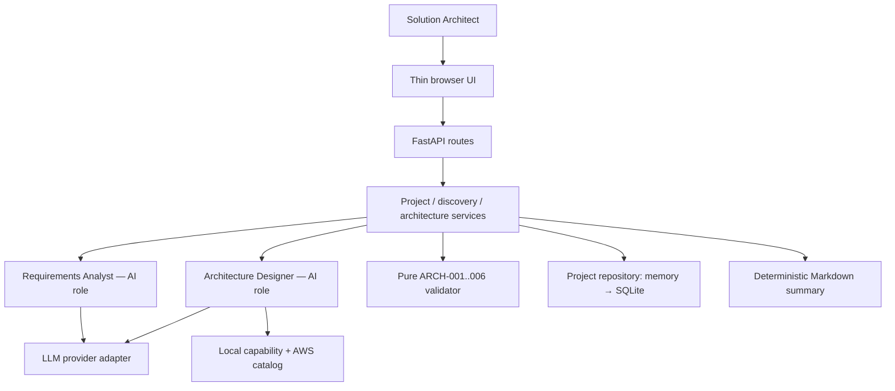
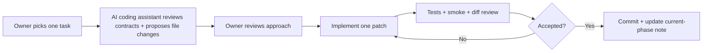

# ArchPilot — Development & Delivery Plan

| Field | Value |
|---|---|
| Document ID | `ARCHPILOT-PLAN-004` |
| Version | **1.0 — Simplified four-month MVP** |
| Prepared | 11 November 2026 |
| Status | **Proposed implementation plan for owner approval; no software is assumed implemented** |
| Owner | Solo developer / Product Owner / Solution Architect |
| Planning horizon | **16 weeks**, approximately **8–12 hours/week** (128–192 total hours) |
| Authoritative references | `01-PRD.md` **v1.1**, `02-SYSTEM-ARCHITECTURE.md` **v1.1**, `03-DATA-CONTRACTS.md` **v1.0** |
| Audience | Project owner, CodeBuddy, Codex, future engineering reviewers |

> **Scope rule:** The revised PRD defines **what** is required; the revised HLD defines major boundaries; the data contracts define proposed interfaces; **this plan only sequences implementation**. If a task conflicts with the PRD, do **not** silently change the product or add functionality. Stop, describe the discrepancy, and request an owner decision. Earlier five-agent blueprints and v1.0 design documents are historical vision, **not active coding instructions**.

---

## 1. Executive delivery summary

**What we are building.** ArchPilot is an AI-assisted solution architecture workbench. A Solution Architect (SA) provides an incomplete customer brief. A **Requirements Analyst** asks prioritized, context-aware questions across multiple rounds and maintains a source-grounded requirements summary. An **Architecture Designer** builds a logical component graph from the selected requirements, with recommendations grounded in a small AWS service catalog. A **deterministic Python validator** checks six explicitly bounded conditions, and a small browser workspace lets the SA inspect, revise, and acknowledge the resulting draft.

**The intended four-month outcome:**

| Month | Main user-visible outcome | Evidence at month-end |
|---|---|---|
| **1 — Discover** | SA can enter a brief, answer targeted follow-ups over **at least three rounds**, see assumptions/conflicts/readiness, and explicitly proceed provisionally. | Recorded walkthrough of PRD AS-01 and AS-02; automated discovery tests. |
| **2 — Design** | Selected discovery state produces an **inspectable provider-neutral architecture graph**, with catalog-grounded AWS suggestions and unknown capabilities visible. | Customer-support and invoice-processing examples generate different valid typed graphs (AS-03). |
| **3 — Validate and review** | SA sees `ARCH-001`–`ARCH-006` findings, inspects a graph, makes or requests a change, revalidates, explicitly accepts a revision, and reloads a saved project. | Positive and negative validator fixtures pass; browser end-to-end demo. |
| **4 — Evaluate and deploy** | Public-data-only demo, concise Markdown summary, held-out comparison against a direct LLM/single-agent baseline, and published limitations. | Reproducible test/evaluation report, deployed URL, setup/deployment instructions. |

**What we are *not* building now:** five independent agents; LangGraph or distributed orchestration infrastructure; a separate Cloud Specialist/Reviewer/Documentation Agent; cloud deployment of **customer** architectures; a live pricing engine; multicloud optimization; enterprise IAM/SSO; full historical event sourcing; automatic change-impact graphs; rich collaborative diagram editing; comprehensive compliance/reliability certification.

### 1.1 Delivery philosophy

1. **Build one vertical slice at a time.** Prefer a working brief → questions → answer → updated state cycle over five incomplete subsystems.
2. **Design at the boundary, not everywhere upfront.** Maintain Pydantic DTOs and a small service boundary; do not scaffold future-only interfaces.
3. **Give CodeBuddy/Codex bounded tasks.** Each task below is small enough for a reviewable patch and has tests and acceptance evidence.
4. **Model output is a proposal, not authority.** Only the backend can preserve evidence, compute readiness, verify catalog mappings, run validators, and record SA decisions.
5. **Use human checkpoints.** The SA chooses when to proceed and whether a particular graph revision has been reviewed.
6. **No quality claim without a measurement.** Report observed benchmark results, including failures and unfavorable comparisons.

### 1.2 What constitutes a milestone versus a task

- **Milestone:** The user-visible outcome at the end of a month.
- **Workstream / legacy phase:** An area of work such as Phase 2 Discovery, reused for traceability.
- **Task:** One independent implementation unit (`M1-T04`, etc.) with an observable behavior, tests, and a clear merge boundary.
- **Definition of Done (DoD):** Conditions that must all hold before a task or milestone is marked complete. “The AI says it is done” is not evidence.

---

## 2. Planning baseline, assumptions and owner decisions

### 2.1 Capacity and effort planning

The 8–12 hours/week assumption leaves **128–192 hours** across 16 weeks. Use these as **planning bands rather than commitments**; unknowns in LLM behavior and frontend integration create uncertainty.

| Period | Working effort budget | Target focus | Protected contingency |
|---|---:|---|---|
| Month 1, Weeks 1–4 | ~30–40 h | Foundation, discovery backend, first thin discovery interface | ~6–8 h |
| Month 2, Weeks 5–8 | ~30–40 h | Graph model, Designer, small catalog, inspectable result | ~6–8 h |
| Month 3, Weeks 9–12 | ~30–40 h | Six rule checks, review UI, revisions, minimal persistence | ~6–8 h |
| Month 4, Weeks 13–16 | ~25–35 h | Evaluation, polish, export, deployment | ~8–12 h |

The reserve is part of the total available time, **not additional committed hours**. Defer optional features before increasing complexity or abandoning tests. The plan assumes one API provider, one active developer, and ordinary local/cloud development tools.

### 2.2 Open decisions — approve before relevant work

These are **not settled by writing this plan**. A decision may be made in a short ADR or the corresponding document's decision ledger.

| Decision | Default proposal, not automatic approval | Decision gate |
|---|---|---|
| `OD-001` LLM | One provider offering structured outputs; use environment-configured key and a fake adapter for tests. | Before `M1-T03` |
| `OD-002` Orchestration | Plain Python functions and explicit user stops; no multi-agent framework. | Before `M2-T04` |
| `OD-003` Readiness | Critical unknown/conflict blocks *ready*; explicit acknowledged *provisional* permits candidate design. | Before `M1-T05` |
| `OD-004` Graph semantics | Provider-neutral nodes, capability IDs, directed typed edges; `consumes` means queue → consumer. | Before `M2-T01` |
| `OD-005` AWS catalog | Approximately 10–15 entries, documented and versioned; not an exhaustive AWS inventory. | Before `M2-T03` |
| `OD-006` Storage | In-memory first; SQLite adapter for restart-safe save/reload when needed. | Before `M3-T04` |
| `OD-007` Demo hosting | Low-cost deployment, synthetic/public content only, server-side secret management and reset capability. | Before `M4-T04` |
| `OD-008` Editing | Readable graph with a small edit/revalidate path or revision request; full drag/drop not necessary. | Before `M3-T02` |
| `OD-009` Evaluation | Held-out synthetic briefs, documented common baseline, same model/available context where practical. | Define rubric in Month 1; freeze before `M4-T02` |

**Architecture Decision Records:** Make an ADR only for a meaningful trade-off (e.g., SDK choice, storage adapter, graph UI strategy). ADRs are short: context → options → decision → consequences. Do not create an ADR for every line of code.

---

## 3. Architecture boundaries and code ownership

### 3.1 Runtime architecture



The two AI roles may share one model/provider. They are **distinct callable responsibilities**, not separate services. The coordinator is plain Python code, not a third agent.

### 3.2 Minimal repository layout (create gradually)

```text
archpilot/
├── README.md
├── CODEBUDDY.md                     # Added after final instruction document
├── backend/
│   ├── app/
│   │   ├── main.py
│   │   ├── api/                      # routes as needed
│   │   ├── models/                   # Pydantic source of truth
│   │   ├── services/                 # discovery, architecture, project, export
│   │   ├── agents/                   # analyst and designer only
│   │   ├── catalog/                  # loaders/mappers, not agent
│   │   ├── rules/                    # pure ARCH checks
│   │   └── adapters/                 # LLM and storage
│   ├── tests/
│   └── pyproject.toml
├── frontend/                         # Introduce when first thin UI is ready
├── catalog/                          # Local versioned capabilities + AWS JSON/YAML
├── examples/synthetic-briefs/
├── docs/                              # PRD, HLD, contracts, plan, evaluation
└── .github/workflows/                # Add lightweight CI when helpful
```

- HTTP routes know Pydantic request/response contracts but **do not prompt LLMs** directly.
- Agent adapters return untrusted **typed proposal objects**, not canonical state or approvals.
- Services reconcile proposals with stored SA statements, manage question status and readiness, and persist current artifacts.
- Rule engine and catalog readers work **offline** and do not need external APIs.
- Frontend displays server-computed state. Never submit `approved`, `catalog_supported` or validator findings as trusted client decisions.
- Pydantic v2 / FastAPI OpenAPI are the runtime schema source of truth; Markdown documents explain intent, not a competing schema registry.

### 3.3 Contract inventory by first use

| First use | Models / contracts | Relevant APIs |
|---|---|---|
| Foundation | Core `ProjectCreate`, `Requirement`/status enums as needed; `HealthResponse`; capability vocabulary | `GET /health` only |
| Month 1 discovery | `Project`, `EvidenceRef`, `Claim`, `ClarificationQuestion`, `QuestionResponse`, `Contradiction`, `DiscoveryState`, `AnalystProposal`, `ProceedRequest` | `POST /api/projects`; discovery analyze/answers/read/proceed |
| Month 2 design | `ArchitectureGraph`, `ArchitectureNode`, `ArchitectureEdge`, `DesignerProposal`, `CatalogService`, `ServiceSuggestion` | Architecture generation; optional early stateless validate |
| Month 3 review | `ValidationFinding`, `ValidationResult`, `ReviewDecision`, minimal `ProjectSnapshot`, stale revision controls | Validate, graph GET/PATCH, human review |
| Month 4 report | Markdown report using current canonical artifacts and benchmark record | `GET /api/projects/{id}/summary.md` |

Do **not** implement all these classes/routes in Phase 0 merely because the technical contract document enumerates them.

---

## 4. Phase and task execution map

**Important:** The labels Phase 0–8 are retained for links to prior documents, but their historical numeric order is **not the delivery schedule**. Month outcomes govern priority. A small piece of Phase 6 (Discovery UI) is built in Month 1; Phase 1's **graph models** precede Phase 1's **complete validation**.

| Legacy phase | Streamlined responsibility | Scheduled implementation |
|---|---|---|
| **Phase 0** | Minimal backend and contract foundation | Month 1, Week 1 |
| **Phase 1** | Graph models and six deterministic rules | Graph model Month 2; all rules Month 3 |
| **Phase 2** | Requirements Analyst and interactive consultative discovery | Month 1 |
| **Phase 3** | Architecture Designer | Month 2 |
| **Phase 4** | Catalog-backed AWS suggestions (no separate agent) | Month 2 |
| **Phase 5** | Plain-Python handoffs, limited revision, human action | Thin workflow Months 1–3 |
| **Phase 6** | Thin Discovery UI; later Architecture Studio | Months 1 and 3 |
| **Phase 7** | Basic save/reload and current revision | Month 3, no full history/impact engine |
| **Phase 8** | Export, held-out evaluation, deployment | Month 4 |

### Task completion standard (applies to every task below)

A task is **Done** only when (a) the specified behavior is implemented at the stated boundary; (b) its positive and negative tests pass; (c) a reviewer can reproduce the acceptance criterion with a fixture/API/browser action; (d) no existing tests fail; (e) relevant contract docs are updated only if the accepted behavior changed; and (f) the patch is committed with a small summary. A passing mock-only test does **not** prove live LLM semantic quality; record which tests are mocked versus live.

---

## 5. Month 1 — Requirements Discovery (Weeks 1–4)

**Month objective:** An SA can conduct **multi-round consultative discovery**, seeing supported facts, assumptions, unanswered questions, contradictions, and explicit readiness. This is the first-class product feature, not just a one-shot extractor.

**Entry criteria:** Revised PRD/HLD/contracts available; `OD-001`/`OD-003` can be resolved before agent integration. No database or frontend framework is needed to begin Phase 0.

### M1-T01 — Foundation: project bootstrap and health API (Phase 0; ~3–4 h)

- **Objective / user value:** A consistent, testable service foundation independent of LLM availability.
- **Implementation:** Create backend package, project setup/lock convention, configuration module, `FastAPI` app with `GET /health -> {"status":"ok"}`, local run instructions, and a `pytest` smoke test. Configure import paths and formatting/lint commands; avoid scaffolding unused directories.
- **Modules/contracts:** `backend/app/main.py`, `backend/tests/test_health.py`, `HealthResponse`, NFR-008/012.
- **Dependencies:** None; select Python version and package manager explicitly.
- **Tests:** Health route returns 200 with exactly expected status; app imports in clean environment; no API key needed for tests.
- **Acceptance / DoD evidence:** `pytest` and `GET /health` pass using documented commands; CodeBuddy provides commands and output; no DB, AI agent, or frontend code introduced.

### M1-T02 — Foundation: minimal schemas, vocabulary and synthetic briefs (Phase 0; ~3–4 h)

- **Objective / user value:** Shared vocabulary and reproducible test inputs before AI is connected.
- **Implementation:** Implement only Phase 0 Pydantic v2 types, enums and input limits needed next; add a versioned capability vocabulary file; create `customer_support.txt`, `media_moderation.txt`, and `invoice_processing.txt` with purely synthetic content. Keep vocabulary about capabilities (e.g., `message_queue`), not named end-to-end solutions.
- **Modules/contracts:** `app/models/`, `catalog/capabilities.json` (or YAML), `examples/synthetic-briefs/`, `ProjectCreate`; FR-001/009; CT-001 groundwork.
- **Dependencies:** M1-T01.
- **Tests:** Blank/oversized brief rejected (422 at route once exposed or model-level rejection now); allowed vocabulary entries load; all 3 briefs are readable; mutable defaults independent.
- **Acceptance / DoD evidence:** Fixtures checked in; schema tests pass; no customer data, backend DB, or LLM integrations.

### M1-T03 — Project + Analyst adapter and typed extraction (Phase 2; ~5–6 h)

- **Objective / user value:** Interpret the brief into candidate functional, non-functional and constraint requirements without inventing confirmed facts.
- **Implementation:** Implement `POST /api/projects` with an in-memory repository; add LLM adapter interface with live and deterministic fake implementations. Implement `RequirementsAnalyst.analyze()` returning `AnalystProposal` (not canonical state). Parse with Pydantic; reconcile source excerpts into backend-owned `Requirement`, `Claim` and `EvidenceRef`. Preserve raw brief. Model-generated IDs and `confirmed` claims are never trusted blindly.
- **Modules/contracts:** `app/api/projects.py`, `app/agents/requirements_analyst.py`, `app/adapters/llm.py`, `app/services/discovery_service.py`, `EvidenceRef`, `AnalystProposal`, FR-001/002; CT-001/002/008/019.
- **Dependencies:** M1-T02; owner selects `OD-001`.
- **Tests:** Mock extraction produces typed candidate requirements; invalid payload gives typed failure and preserves state; an invented 99.99% SLA is not promoted to confirmed without evidence; prompt injection does not grant tools/approval.
- **Acceptance / DoD evidence:** A synthetic brief can be submitted and analyzed via API test client; raw text remains unchanged; LLM failures do not corrupt session state.

### M1-T04 — Prioritized question generation and answer handling (Phase 2; ~4–5 h)

- **Objective / user value:** The SA can ask the right client questions and record what was answered, deferred, skipped or irrelevant.
- **Implementation:** Extend Analyst proposals with 3–5 useful question candidates per round (display default, not a hard schema limit). Create `ClarificationQuestion` with priority, rationale, affected decisions and related requirements. Implement `POST .../discovery/answers` validating action/answer text; retain dispositions and stable backend-generated IDs; basic normalized-question deduplication.
- **Modules/contracts:** `ClarificationQuestion`, `QuestionResponse`, `SubmitAnswersRequest`, `app/services/discovery_service.py`; FR-003/005; CT-003/004.
- **Dependencies:** M1-T03.
- **Tests:** Empty text for `answer` rejected; defer vs skip vs N/A not marked confirmed; duplicate candidate question is not duplicated; answering existing question does not change another answer.
- **Acceptance / DoD evidence:** API response exposes ranked questions with a reason and correctly stored answer status; automated tests cover each action.

### M1-T05 — Multi-round discovery, contradiction, readiness and provisional choice (Phase 2 + thin Phase 5; ~6–8 h)

- **Objective / user value:** A continuing discovery conversation instead of a one-shot Q&A generator.
- **Implementation:** Add `POST .../discovery/analyze`, `GET .../discovery`, and `POST .../discovery/proceed`; merge new Analyst proposals into canonical `DiscoveryState`; maintain prior questions/answers; implement contradictions with both source claims retained; compute `blocking_item_ids` and `needs_clarification`/`ready_for_design`; require explicit SA acknowledgement for `provisional`. Include `state_revision` checks (409 for stale writes) if endpoint updates can race.
- **Modules/contracts:** `DiscoveryState`, `Contradiction`, `ProceedRequest`, `DiscoveryReadiness`, `app/services/discovery_service.py`, `app/services/project_service.py`; FR-004/006/007/008/015; AS-01/AS-02; CT-003/005/006/007/016.
- **Dependencies:** M1-T04; approve `OD-003`.
- **Tests:** At least 3 rounds preserve answered facts; no duplicate repeat of answered questions; EU-only vs US-only conflict retains both claims and blocks ready; provisional without acknowledgement is rejected; accepted acknowledgement keeps blockers visible; stale revision is rejected without mutation.
- **Acceptance / DoD evidence:** Automated AS-01 and AS-02 reproductions pass using mocked LLM; server never infers SA approval or erases an unresolved contradiction.

### M1-T06 — Thin Discovery Workspace and first vertical-slice demo (early Phase 6; ~5–7 h)

- **Objective / user value:** SA can use discovery without editing JSON or using Swagger manually.
- **Implementation:** Create a minimal browser UI (proposed Next.js + TypeScript) showing brief entry, current requirements by knowledge status, prioritized questions, per-question answer/defer/skip/N/A, readiness, and explicit “Proceed provisionally” confirmation. Call the documented API. Keep simple cards/forms rather than dashboards; no React Flow or architecture editor yet.
- **Modules/contracts:** `frontend/` discovery page/client, `/api/projects` and discovery routes; FR-017, NFR-010.
- **Dependencies:** M1-T05.
- **Tests:** Smoke test brief → analyze → answer → analyze again; provisional confirmation visibly includes open blockers; API errors are shown instead of silently dropped; no secret is sent to browser.
- **Acceptance / DoD evidence:** A short screen recording or reproducible live demo completes 3 rounds and shows contradiction/provisional state. No graph features are required for Month 1.

**Month 1 exit gate (M1-GATE):** All M1 tasks merged and tests pass; AS-01/AS-02 reproduced; `CT-001`–`CT-008` relevant to discovery plus `CT-016/019` tests run where implemented; human can use thin discovery UI. **If blocked by frontend time:** a minimal HTML/static form is acceptable as an interim UI, with the intended browser experience completed early Month 2. Do not substitute a polished landing page for the discovery workflow.

---

## 6. Month 2 — Architecture Generation & AWS Catalog (Weeks 5–8)

**Month objective:** Turn a selected discovery state into a **provider-neutral graph** that composes reusable capabilities, then optionally associate supported AWS services using versioned catalog data. The system must remain honest about unknowns.

**Entry criteria:** M1 discovery produces a stable `DiscoveryState` with evidence/answers and explicit readiness/provisional choice; core API tests pass. Approve `OD-004`, `OD-005`, and coordination approach `OD-002` before code depends on them.

### M2-T01 — Architecture graph DTOs and structural checks (Phase 1 foundation; ~4–5 h)

- **Objective / user value:** An architecture is a machine-readable engineering artifact, not only prose or an image.
- **Implementation:** Implement `ArchitectureGraph`, `ArchitectureNode`, `ArchitectureEdge`, `GraphEdgeKind`; preserve `source_discovery_revision`; backend owns canonical IDs/revisions. Keep logical `capability_ids` separate from AWS service suggestions. Create basic graph fixture for each synthetic brief. Implement early tests for duplicate IDs and dangling edges, without completing all six validator rules yet.
- **Modules/contracts:** `app/models/architecture.py`, `app/rules/`, `ArchitectureGraph`, `ARCH-001`/`ARCH-002` groundwork; FR-009/010; CT-010/011.
- **Dependencies:** M1-GATE.
- **Tests:** Typed graph round-trip; duplicate IDs can be parsed and then explicitly reported by rule engine (Pydantic must not silently discard them); dangling edge reported; invalid enum rejected at schema layer.
- **Acceptance / DoD evidence:** Sample graph JSON renders/serializes correctly and structural findings are reproducible.

### M2-T02 — Architecture Designer with catalog-independent logical graph (Phase 3; ~5–6 h)

- **Objective / user value:** Produce new graph combinations based on requirements, rather than choosing prebuilt use-case diagrams.
- **Implementation:** Define `DesignerProposal` and `ArchitectureDesigner.generate()`. Feed only selected requirements, current readiness/provisional blockers, supported capability vocabulary, and explicit constraints; request nodes, typed edges, requirement links, and rationales. Backend parses/canonicalizes/labels draft. Expose `POST .../architectures/generate` behind a backend check that SA explicitly chose ready/provisional. No broad service catalog dependency required at first.
- **Modules/contracts:** `app/agents/architecture_designer.py`, `app/services/architecture_service.py`, `GenerateArchitectureRequest`, `DesignerProposal`, `ArchitectureGraph`; FR-009/010/015; AS-03.
- **Dependencies:** M2-T01; M1-T05. Owner approves `OD-002`/`OD-004`.
- **Tests:** Mock Designer responses for different briefs create distinct graphs with requirement links; no graph is generated from unapproved blocked discovery; malformed output leaves last valid graph untouched; direct model-supplied acceptance is ignored.
- **Acceptance / DoD evidence:** Customer support and invoice processing use different capability combinations; provider-neutral graph JSON is returned with rationale and unknowns.

### M2-T03 — Small curated AWS catalog and verified mapping gate (slim Phase 4; ~4–6 h)

- **Objective / user value:** Suggestions point to recognizable supported cloud services without hallucinated “verified” claims.
- **Implementation:** Create versioned local catalog with approximately **10–15 AWS entries**. Record `service_id`, `capability_ids`, short purpose, limitations, official `documentation_url`, `last_reviewed_on`, `catalog_version`, and known dependency semantics where applicable. Implement a read-only catalog loader and deterministic mapping check: `catalog_supported` requires known service ID **and compatible capability**. Unsupported/unverified suggestions must stay visibly unverified.
- **Modules/contracts:** `catalog/aws_services.json`, `app/catalog/`, `CatalogService`, `ServiceSuggestion`; FR-011; CT-009. No separate Cloud Specialist agent.
- **Dependencies:** M2-T01; owner `OD-005` decision.
- **Tests:** Unknown service cannot be marked `catalog_supported`; mismatched capability rejected/reclassified; catalog version persists in result; offline load works; malformed metadata fails validation.
- **Acceptance / DoD evidence:** Sample AWS suggestions identify the catalog source and limitations; no live pricing/region guarantees; owner or CodeBuddy verifies catalog source URLs during data entry.

### M2-T04 — Integrate Designer, catalog, human gates and bounded errors (thin Phase 5; ~4–5 h)

- **Objective / user value:** One predictable pipeline from reviewed requirements to candidate graph.
- **Implementation:** Plain-Python coordinator: resolve current project and `state_revision` → require SA ready/provisional decision → provide relevant catalog entries to Designer → parse result → verify mapping statuses → run available structural checks → save current draft with source discovery revision. Bound invalid-output retry (default proposal: at most one) and return explicit stage errors. Never silently declare a draft reviewed.
- **Modules/contracts:** `app/services/architecture_service.py`, `app/adapters/llm.py`, graph response models, error envelope; FR-015/019; NFR-003/004/006/009.
- **Dependencies:** M2-T02, M2-T03.
- **Tests:** Successful graph has proper `source_discovery_revision`; invalid map not verified; timeouts and malformed JSON have visible errors; zero infinite retries; user approval absent by default.
- **Acceptance / DoD evidence:** A single API invocation after discovery produces one traceable draft or one actionable failure; no extra agent framework introduced.

### M2-T05 — Inspectable architecture output (early Phase 6; ~4–6 h)

- **Objective / user value:** SA can understand a proposed design and why components exist.
- **Implementation:** Extend the thin UI with a simple generated graph/diagram using a lightweight renderer (Mermaid or React Flow read-only, choose one). Show selected requirement links, component purpose, suggested AWS service with `catalog_supported`/`unverified` label, unresolved capabilities, and provisional banner. Avoid advanced drag/drop and provider logos.
- **Modules/contracts:** `frontend/` architecture view, `ArchitectureResponse`; FR-010/011/018/NFR-007/010.
- **Dependencies:** M2-T04.
- **Tests:** Basic UI renders sample graph; selection reveals node purpose/requirements; unverified suggestions and provisionals clearly visible; no runtime crashes on missing/empty graph.
- **Acceptance / DoD evidence:** SA can enter an unfamiliar invoice-processing brief, finish discovery, generate a candidate graph and inspect why each major node is present.

**Month 2 exit gate (M2-GATE):** AS-03 with an invoice-processing **unseen whole-use-case template** and at least one substantially different workload; typed graph and references inspectable; AWS mapping statuses are enforced by code. Graph may have warnings or unsupported capabilities, but the system must **show them**, not fabricate coverage. Full `ARCH-003`–`ARCH-006` implementation remains Month 3 work.

---

## 7. Month 3 — Deterministic Validation & Architecture Studio (Weeks 9–12)

**Month objective:** Make the design reviewable and reproducibly checkable, not merely present a polished diagram. Add lightweight persistence and explicit SA review of a particular revision.

**Entry criteria:** M2-GATE; typed graphs and catalog checks exist. Owner chooses `OD-008` edit scope and `OD-006` storage adapter before implementation.

### M3-T01 — Complete `ARCH-001`–`ARCH-006` pure validator (Phase 1 completion; ~6–8 h)

- **Objective / user value:** Identify known, bounded architecture mistakes with repeatable evidence.
- **Implementation:** Implement pure functions for all six rules with `ValidationFinding`/`ValidationResult` and deterministic ordering. Keep parsing/schema errors separate from topology (`ARCH-001/002/003/004/005`) and discovery readiness (`ARCH-006`). `ARCH-005` uses explicit queue-consumer semantics from the catalog; missing/ambiguous metadata produces warning rather than invented certainty. `ARCH-006` preserves readiness blockers even when SA proceeds provisionally.
- **Modules/contracts:** `app/rules/arch_001_006.py`, validation schemas, `/api/architectures/validate`; FR-013, NFR-005; CT-010–015/018.
- **Dependencies:** M2-T01/03; canonical discovery state.
- **Tests:** At least one positive + negative fixture per rule, mixed structural-clean/provisional graph, stable output across repeat runs and inputs, queue→worker `consumes` semantics explicitly tested, no LLM/network dependency.
- **Acceptance / DoD evidence:** Six rules demonstrate precise expected findings. `graph_rules_passed=true` may coexist with unresolved `readiness_blockers`; no “production-ready” status is emitted.

### M3-T02 — Architecture Studio review UI and findings (Phase 6; ~5–7 h)

- **Objective / user value:** SA can inspect graph, issues, referenced requirements, and request improvements.
- **Implementation:** Add findings panel with rule IDs/severity, affected component links, graph-detail inspection and explicit “Request revision” control. Provide **one** simple edit path, preferably a form using the existing graph PATCH contract. If the owner instead chooses an AI revision instruction, document and approve its endpoint/contract change before coding (`OD-008`). Implement a review-state display but do not build enterprise approval history.
- **Modules/contracts:** `frontend/` architecture workspace, `ArchitectureResponse`, `ValidationResult`; FR-016/018/019.
- **Dependencies:** M3-T01.
- **Tests:** Clicking findings highlights referenced IDs when present; an invalid graph shows problems; a clean graph with unresolved critical question shows readiness warning; mock failure is visible.
- **Acceptance / DoD evidence:** Reproducible browser demonstration from candidate graph → finding → revision request/limited edit, without switching to Swagger.

### M3-T03 — Server-controlled revise, revalidate and SA review (thin Phase 5; ~4–5 h)

- **Objective / user value:** Human review refers to a specific revision; a subsequent change cannot inherit approval.
- **Implementation:** Implement `PATCH .../architecture` for minimal graph edits (a focused AI revision endpoint requires separate owner-approved contract change), `POST .../architecture/review` with `graph_id`, `expected_graph_revision`, action and optional comment. Backend increments revision, reruns validation, resets review to `draft`/`revision_requested`, and enforces stale-revision 409. A user can `accepted_by_sa` only through an explicit action. Acceptance is **review acknowledgement**, never certification.
- **Modules/contracts:** `UpdateArchitectureRequest`, `ReviewDecisionRequest`, `DesignReviewStatus`, graph revision in `app/services/architecture_service.py`; FR-015/016/018; CT-016/017.
- **Dependencies:** M3-T02; OD-008 decision.
- **Tests:** Accept rev 1 → edit to rev 2 → review state not inherited; stale update rejected; client-supplied approved/finding fields ignored; changes cause revalidation.
- **Acceptance / DoD evidence:** UI and API show the current reviewed/draft revision correctly; no agent auto-approval.

### M3-T04 — Minimal durable storage and project reopen (slim Phase 7; ~4–6 h)

- **Objective / user value:** Demo project survives a restart and retains requirements/answers/design.
- **Implementation:** Introduce one small repository adapter storing the **current** `ProjectSnapshot`; choose SQLite by default (owner approval) with schema-version field and simple load/save. Store raw brief, claims, questions, responses, conflicts, readiness and acknowledgement, graph/revision and review status. Preserve in-memory repository for fast tests. Avoid multi-table event sourcing, migration frameworks or user accounts.
- **Modules/contracts:** `app/adapters/storage.py`, `ProjectSnapshot`, FR-008/020; CT-020; OD-006.
- **Dependencies:** M1 state models, M3-T03.
- **Tests:** Save → restart/reload → same active claims, answered question dispositions, open contradictions, graph revision and review status; missing/corrupt record yields typed error; no credentials persisted.
- **Acceptance / DoD evidence:** Close/restart application and reopen a sample project without losing state; reset/clear mechanism for demo data exists or is planned for Month 4.

### M3-T05 — End-to-end hardening (Phase 1/6 integration; ~3–5 h)

- **Objective / user value:** All month-1–3 features behave together, including failures.
- **Implementation:** Exercise browser + API workflows; add consistent error envelopes, loading states, capped client requests, stale-revision handling, and basic request logging with run ID. Fix critical integration defects; do not add new agent roles or sophisticated telemetry platform.
- **Modules/contracts:** API error DTOs, frontend API client, test fixtures; FR-019, NFR-003/006/009/010.
- **Dependencies:** M3-T01–04.
- **Tests:** End-to-end three-round discovery → provisional/ready → draft → ARCH findings → revision → accept → save/reload; timeout and 409 show intelligible UI messages.
- **Acceptance / DoD evidence:** Human reviewer completes a full workflow with synthetic data and no direct backend/JSON editing.

**Month 3 exit gate (M3-GATE):** `ARCH-001`–`ARCH-006` positive/negative suite passes; accepted revision is explicit; user can revise and revalidate; persistence/reopen works; no false “certified” display. If behind schedule, reduce visual editing sophistication **before** reducing validator correctness.

---

## 8. Month 4 — Evaluation, Refinement & Deployment (Weeks 13–16)

**Month objective:** Validate ArchPilot against its claimed value, communicate limitations honestly, and deliver a reproducible public-data-only demo.

**Entry criteria:** M3-GATE achieved or documented remaining defects have owners and planned fixes; evaluation protocol `OD-009` frozen **before** running held-out cases; hosting `OD-007` approved before any public access.

### M4-T01 — Concise Markdown architecture summary (Phase 8; ~3–4 h)

- **Objective / user value:** SA can share a clear reviewable artifact without a dedicated Documentation Agent.
- **Implementation:** Implement deterministic Markdown rendering from canonical state: brief and requirements, assumptions/conflicts, readiness/provisional flag, logical components/relations, catalog suggestions with caveats, `ARCH` findings, current graph ID/revision, and SA review status. Expose `GET .../summary.md`. Optional diagram as Mermaid text may be included if safe and reproducible.
- **Modules/contracts:** `app/services/summary_renderer.py`, `/api/projects/{id}/summary.md`; FR-022; NFR-007.
- **Dependencies:** M3-GATE.
- **Tests:** Known sample exports all required sections and unresolved blockers; edits reflected in next export; no approval/certification claim when not explicit; no API key/secret leakage.
- **Acceptance / DoD evidence:** Reviewer can read the Markdown and identify exactly what is confirmed versus provisional.

### M4-T02 — Held-out benchmark and fair baseline (Phase 8; ~5–7 h)

- **Objective / user value:** Determine where ArchPilot improves on direct prompting and where it does not.
- **Implementation:** Freeze a **separate 10–20-brief synthetic benchmark**, including at least several held-out scenarios and conflicting constraints. Define answer keys/rubric for missing critical questions, retained facts/contradictions, graph rule failures, generalization, and usefulness. Run ArchPilot and a well-specified **single-agent/direct-prompt** baseline using the same model and access to comparable AWS catalog/reference context where practical. Record latency, number of model calls, token usage/estimated cost when API reports allow, and failures. Keep test prompts, model settings, catalog version and scoring notes.
- **Modules/contracts:** `evaluation/fixtures/held_out/`, `evaluation/run_benchmark.py`, `evaluation/rubric.md`, FR-024; CT-001–020 as support; OD-009.
- **Dependencies:** M3-GATE; baseline protocol approved before evaluation; do not tune using held-out set.
- **Tests:** Re-run deterministic scorer from saved outputs; human-review rubric clearly distinguishes objective rule scores and subjective architecture usefulness; sample size and limitations reported.
- **Acceptance / DoD evidence:** Tables of observed results (not promised wins), representative successes and failure examples, and a written conclusion about whether two-agent workflow was worth complexity.

### M4-T03 — Fix highest-impact evaluation defects and security review (Phase 8; ~4–6 h)

- **Objective / user value:** Deliver a dependable portfolio demo rather than adding low-value features.
- **Implementation:** Prioritize issues by severity and user impact: invented facts, lost answers, contradiction mishandling, catalog overclaims, validator false positives/negatives, stale review. Run prompt-injection negative tests, secret scanning, privacy review and input-limiting tests. Lock scope against optional features after this point.
- **Modules/contracts:** Existing backend/frontend tests, NFR-001–013 as applicable; CT-002/005/008/009/016/019.
- **Dependencies:** M4-T02 initial results.
- **Tests:** Regression tests for each fixed critical issue; no live secrets in logs, exports, browser bundle, or Git; CI remains green.
- **Acceptance / DoD evidence:** Issue list shows what was fixed, what remains, and why any lower-severity defect is accepted for demo.

### M4-T04 — Deploy synthetic/public demo with safe configuration (Phase 8; ~5–7 h)

- **Objective / user value:** A reviewer can use the product without running your development machine.
- **Implementation:** Choose low-cost hosting; configure frontend/backend origins and CORS, server-side secrets, request/body limits and model-cost guardrails, storage/reset suitable for demo. Keep project storage non-sensitive; choose retention/reset strategy. Document environment variables and local/deployed commands. Containerization only if needed by host. Avoid customer AWS permissions/credentials entirely.
- **Modules/contracts:** deployment files/settings, README, NFR-001/002/006/012/013; OD-007.
- **Dependencies:** M4-T03; deployment host selected.
- **Tests:** Fresh deployment smoke: `/health`, project creation, discovery round, graph generation, findings, export; verify secrets not exposed; reset demonstration data; failed LLM key produces safe error.
- **Acceptance / DoD evidence:** Working demo URL (or private access if public exposure too risky), documented setup and rollback/reset instructions, reproducible smoke-test record.

### M4-T05 — Portfolio handoff and technical review (Phase 8; ~3–5 h)

- **Objective / user value:** Make the project intelligible to a hiring manager or another engineer.
- **Implementation:** Finalize `README.md`, architectural diagrams reflecting **implemented** system (not future vision), quick-start commands, 3-minute demo script, screenshots, limitations, key ADRs, evaluation summary and future improvements. Compare actual implementation with PRD; explicitly mark deferred tasks and remaining open decisions.
- **Modules/contracts:** project docs, demo walkthrough; FR-024; NFR-008/012.
- **Dependencies:** M4-T01–04.
- **Tests:** Fresh clone/setup or environment rebuild reproduces startup and core tests; a peer can follow instructions without needing your chat history.
- **Acceptance / DoD evidence:** Repository is demonstration-ready and evaluation claims are supported by recorded outputs.

**Month 4 exit gate (RELEASE-GATE):** M1–M3 workflow works end-to-end; synthetic demo deployment passes smoke tests; benchmark and direct-prompt baseline results are published with limitations; Markdown export preserves unresolved issues; the repository is reproducible from instructions.

---

## 9. End-to-end acceptance suite and requirement traceability

### 9.1 Three must-pass product stories

| Story | Test data | Must observe | Coverage |
|---|---|---|---|
| **AS-01** Incomplete support brief | 10,000 conv/day, English/Chinese, internal documentation, sensitive data, “limited budget” | Analyst identifies budget, data location/handling, peak load and question-answer vs actions; 3-round answer persistence; no invented SLA/spend. | FR-001–005/007/017; CT-001–004 |
| **AS-02** Contradictory regions | EU-only customer data; US-only inference | Both claims retained; conflict open until SA resolves; blocker visible even if provisional. | FR-006/007; CT-005–007 |
| **AS-03** Unfamiliar invoice processing | PDF invoices → extract → save → human review/notify | Designer composes capabilities from vocabulary, not whole-use-case template; unsupported suggestions remain labeled; graph schema-valid and inspectable. | FR-009–011; CT-009–013 |

### 9.2 Contract test map (`03-DATA-CONTRACTS.md`)

| Set | Test IDs | Recommended delivery |
|---|---|---|
| Basic input and provenance | `CT-001`, `CT-002` | M1-T02–03 |
| Discovery states, conflict, provisional | `CT-003`–`CT-007` | M1-T04–06 |
| Model parse safety | `CT-008` | M1-T03 and M2-T04 |
| AWS catalog truthfulness | `CT-009` | M2-T03–04 |
| Graph rules | `CT-010`–`CT-015` | M2-T01, M3-T01 |
| Concurrency/review | `CT-016`, `CT-017` | M1-T05 (state), M3-T03 (graph) |
| Determinism | `CT-018` | M3-T01 |
| Prompt injection boundaries | `CT-019` | M1-T03, M4-T03 |
| Save/reload | `CT-020` | M3-T04 |

**Contract-test index:** `CT-001`, `CT-002`, `CT-003`, `CT-004`, `CT-005`, `CT-006`, `CT-007`, `CT-008`, `CT-009`, `CT-010`, `CT-011`, `CT-012`, `CT-013`, `CT-014`, `CT-015`, `CT-016`, `CT-017`, `CT-018`, `CT-019`, `CT-020`. The exact behavior of each is defined in `03-DATA-CONTRACTS.md` §10.1; do not redefine its meaning here.

### 9.3 Release-critical functional requirements

**MVP:** `FR-001`–`FR-007`, `FR-009`–`FR-011`, `FR-013`, `FR-017`, `FR-024`.

**Lite MVP (simplified implementation, not deferred wholesale):** `FR-008`, `FR-015`, `FR-016`, `FR-018`, `FR-019`, `FR-020`, `FR-022`.

**Optional:** `FR-012` only if time remains **after release gates pass**.

**Future — exclude from tasks:** `FR-014`, `FR-021`, `FR-023` and the advanced versions of Lite MVP items.

**Non-functional requirements:** Treat `NFR-001`–`NFR-013` as cross-cutting constraints introduced and tested at the relevant stage; do not interpret them as separate new services.

### 9.4 Exact requirement ownership (no hidden phase tasks)

The ranges above are shorthand; this index assigns **every current requirement ID** to a task or an explicit non-MVP disposition. The task's acceptance section defines the detailed evidence.

| Requirement IDs | Primary owner task(s) | Delivery |
|---|---|---|
| `FR-001`, `FR-002` | `M1-T03` (bootstrap contracts in `M1-T02`) | MVP |
| `FR-003`, `FR-005` | `M1-T04` | MVP |
| `FR-004`, `FR-006`, `FR-007` | `M1-T05` | MVP |
| `FR-008` | `M1-T05`, `M3-T04` | Lite MVP |
| `FR-009`, `FR-010` | `M2-T01`, `M2-T02` | MVP |
| `FR-011` | `M2-T03`, `M2-T04` | MVP |
| `FR-012` | None unless owner explicitly authorizes after release gates | Optional |
| `FR-013` | `M3-T01` | MVP |
| `FR-014` | No task; separate reviewer agent deferred | Future |
| `FR-015` | `M1-T05`, `M2-T04`, `M3-T03` | Lite MVP |
| `FR-016` | `M3-T03` | Lite MVP |
| `FR-017` | `M1-T06` | MVP |
| `FR-018` | `M2-T05`, `M3-T02`, `M3-T03` | Lite MVP |
| `FR-019` | `M2-T04`, `M3-T05` | Lite MVP |
| `FR-020` | `M3-T04` | Lite MVP |
| `FR-021` | No task; full change-impact engine deferred | Future |
| `FR-022` | `M4-T01` | Lite MVP |
| `FR-023` | No task; priced cost engine deferred | Future |
| `FR-024` | `M4-T02`, `M4-T05` | MVP |

| Non-functional ID | Verification owner task(s) | Evidence focus |
|---|---|---|
| `NFR-001` | `M1-T02`, `M4-T03`, `M4-T04` | Public/synthetic data only |
| `NFR-002` | `M4-T03`, `M4-T04` | Secret handling, scan |
| `NFR-003` | `M1-T03`, `M4-T03` | Prompt/tool boundary |
| `NFR-004` | `M1-T03`, `M2-T04` | Typed LLM proposal parsing |
| `NFR-005` | `M3-T01` | Deterministic findings |
| `NFR-006` | `M2-T04`, `M3-T05` | Timeout, retries, errors |
| `NFR-007` | `M2-T01`, `M2-T05`, `M4-T01` | Requirement traceability |
| `NFR-008` | `M1-T01`, `M4-T05` | Maintainable modules/tests |
| `NFR-009` | `M2-T04`, `M3-T05` | Basic run metadata logging |
| `NFR-010` | `M1-T06`, `M3-T02` | Full browser workflow |
| `NFR-011` | `M4-T02` | Measured performance/cost |
| `NFR-012` | `M1-T01`, `M4-T04` | Local/deployed setup |
| `NFR-013` | `M4-T04` | Reset/retention controls |

**Exact validation ownership:** `ARCH-001` and `ARCH-002` start in `M2-T01`; `ARCH-003`, `ARCH-004`, `ARCH-005`, and `ARCH-006` are implemented and fully tested in `M3-T01`. Their boundaries must remain the six definitions in the PRD/HLD/contracts, not expanded architecture certifications.

---

## 10. Verification strategy throughout development

### 10.1 Test layers

| Layer | Tool / approach | Runs when | Why |
|---|---|---|---|
| Schema unit tests | `pytest`, Pydantic fake data | Every backend change | Prevent contract drift. |
| Pure rules unit tests | `pytest`, fixed graph fixtures | Every validator change | Reproducible named findings. |
| Mocked agent contract tests | Fake LLM adapter with good/bad payloads | Every agent/service change | Test orchestration and failures without external calls. |
| FastAPI integration tests | `TestClient` or HTTPX test client | Every API change | Verify status codes, boundaries and error envelopes. |
| Frontend component/smoke tests | Lightweight selected framework | Every UI change | Basic navigation, displayed warnings and errors. |
| Manual end-to-end walkthrough | Synthetic brief/SA answers | Every month exit gate | Check that a person can actually use it. |
| Live-model smoke/evaluation | Small controlled sample; spending cap | At chosen milestones | Assess semantic quality not captured by mocks. |
| Held-out comparative benchmark | Frozen samples and rubric | Month 4 | Test unique value versus a baseline. |

**Not every task needs a new testing framework.** Start with `pytest`; add frontend test tooling only when there are meaningful UI behaviors to check. Prefer reproducible test fixtures over flaky live-model CI.

### 10.2 Non-functional verification

- **Privacy:** all examples synthetic; public demo explicitly warns against private/company data; no proprietary Tencent or client documents.
- **Secret handling:** `.env` excluded from Git; backend-only API keys; simple automated scan before deployment; never return secrets in trace/error payloads.
- **LLM robustness:** typed outputs, timeout, bounded retries, previous-good-state preservation, explicit error codes.
- **Agent boundaries:** user instructions inside customer briefs cannot trigger shell/cloud actions or mark architecture accepted.
- **Traceability:** each major node explains its purpose via requirement IDs or cross-cutting rationale.
- **Determinism:** validator is LLM-free and normalizes output ordering; catalog/rule version captured.
- **Observability:** log run ID, stage, elapsed time and error type; avoid raw briefs/answers in logs.
- **Deployment:** clean-environment run and deployed smoke tests; reset synthetic state.

### 10.3 Evidence package per task

A completed CodeBuddy/Codex task must return:

1. **File list and summarized diff** (what changed and why).
2. **Commands run and outputs** (tests/lint/smoke); note any tool that was *not* run.
3. **Acceptance evidence** (test name, API response example, or screenshot for a UI change).
4. **Known limitations/risks** and whether documentation needs updating.
5. **Next bounded task suggestion**, not a surprise implementation of the next phase.

If a test depends on a secret/API key not available to the agent, it must report the test as **not run** and provide a mocked substitute; do not claim live verification.

---

## 11. Practical CodeBuddy / Codex workflow

### 11.1 Workflow for each small task



**First prompt: plan, do not modify code.** Require CodeBuddy/Codex to inspect the current repository and identify only the files relevant to that task. Ask it to call out contract contradictions or over-engineering risks before coding.

**Second prompt: implement approved scope.** Permit tests and short documentation updates. Forbid unrelated refactors, agent proliferation, frameworks added without justification, credentials in code, and the next task's functionality.

**Third prompt: audit implementation.** Request a concise checklist comparing intended acceptance criteria with tests and what remains unproven; independently inspect the diff yourself.

### 11.2 Copy-ready planning prompt

```text
Read docs/01-PRD.md v1.1, docs/02-SYSTEM-ARCHITECTURE.md v1.1,
docs/03-DATA-CONTRACTS.md v1.0, docs/04-DEVELOPMENT-PLAN.md,
and CODEBUDDY.md if present.

Current task: <TASK-ID> — <TASK-NAME>.

DO NOT CHANGE CODE YET.
1. Inspect relevant existing modules and tests.
2. Explain the implementation in 5–10 concise steps.
3. List exact files to add or edit.
4. Identify relevant FR/NFR/CT/ARCH IDs and contracts.
5. Identify dependencies, edge cases, and failure behavior.
6. Give the proposed test cases and runnable commands.
7. Flag any disagreement with existing documents; don't silently change scope.

Stop after the plan and await approval.
```

### 11.3 Copy-ready implementation prompt

```text
Implement ONLY task <TASK-ID> according to the approved implementation plan.
Stay within the four-month two-agent MVP and existing contracts.

Required:
- implement the stated behavior and negative cases;
- add or update focused automated tests;
- run relevant tests and report exact results;
- avoid unrelated refactors, new agents, extra cloud services or future-phase scaffolding;
- do not invent customer facts, cloud certifications or pricing data;
- summarize the diff, acceptance evidence, known limitations, and next task.

If implementation requires changing an approved public contract, STOP and propose the
change with its consequences before making it.
```

### 11.4 Git practice (lightweight, not enterprise process)

- `main` holds a working, tested checkpoint at each milestone.
- Create a short-lived branch per substantive task, e.g. `feat/m1-t05-discovery-state` or `fix/arch-005-queue-check`.
- One task may use a few small commits; avoid a month-long branch and sweeping “build all phases” commits.
- Commit messages should explain changes: `feat(discovery): preserve answered questions across rounds`.
- Review **diff, tests, accidental scope additions and new dependencies** before merging. For a solo project, a self-review checklist is sufficient; a separate human reviewer is ideal but not required.
- Keep generated docs and test fixtures in Git; never commit `.env`, real briefs, logs, model credentials, or provider response dumps containing sensitive content.
- Small CI pipeline: install backend dependencies → run `pytest` (later lint/type checks and lightweight frontend checks). Don't trigger live LLM calls in routine CI.
- At each month gate, tag an optional checkpoint (`m1-discovery`, `m2-design`, etc.) and keep demo evidence or reproducible test notes.

### 11.5 Keeping documents current

- `01-PRD.md`: edit only for actual product scope/acceptance changes.
- `02-SYSTEM-ARCHITECTURE.md`: update accepted component boundaries and material architectural choices; diagrams should reflect implementation.
- `03-DATA-CONTRACTS.md`: update when canonical schema/API shapes change; cross-check OpenAPI and tests.
- `04-DEVELOPMENT-PLAN.md`: update progress, risk, order and owner-approved deferrals; do not use it to expand the PRD.
- `05-EVALUATION-PLAN.md`: freeze baseline protocol **before** final held-out evaluations.
- `CURRENT-PHASE.md` (optional): 5–10 lines on what passed, what's next, open blockers, latest commit; not an alternative source of truth.
- Record short ADRs when real design decisions arise; revisit `OD-*` list at month transitions.

---

## 12. Entry and exit gates — owner sign-off sheet

| Gate | Entry must be true | Exit / evidence required | Owner decision |
|---|---|---|---|
| **G0 Foundation** | Basic repository and working local Python | `/health` + basic schema tests + 3 synthetic briefs; no AI/DB/UI | Approve core conventions |
| **G1 Month 1 Discovery** | G0; LLM chosen; readiness policy agreed | Three-round Q&A, conflict, provisional flow via thin browser UI; mocked regression tests | Proceed to architecture generation |
| **G2 Month 2 Design** | G1; graph semantics/catalog approved | Typed graph from two distinct briefs; mapping validation; limitations visible | Approve rule completion and review UI |
| **G3 Month 3 Review** | G2; selected edit/storage approaches | `ARCH-001`–`006` seeded pass; revise/revalidate; SA accept revision; save/reopen | Freeze scope for benchmark |
| **G4 Month 4 Release** | G3; frozen benchmark; hosting approved | Public/safe demo, Markdown export, fair baseline evaluation, README and limitations | Accept portfolio release |

**Gates are evidence-based.** If a planned week ends but a critical gate fails, fix that behavior or formally document a reduced-scope decision. Do not auto-advance because a calendar date passed.

---

## 13. Risks, triggers and scope-cut policy

| Risk | Early warning | Response (ordered by impact) |
|---|---|---|
| Discovery AI repeats or invents facts | AS-01 fails, repeated questions persist | Improve prompt/evidence reconciliation and question state before building Designer. |
| Contradiction handling loses evidence | AS-02 old claim disappears | Preserve source claims; require explicit SA resolution; block ready. |
| Architecture graphs are superficial or invalid | Many missing links/capabilities; repeated schema errors | Reduce catalog breadth; stabilize graph schema and generation prompt; make unknowns explicit. |
| AWS recommendations hallucinate certainty | `catalog_supported` appears for unknown service | Enforce backend catalog gate and inspect sources; never rely on LLM confidence. |
| Rules overclaim safety | UI says “production-ready” after 6 checks | Replace with bounded structural/readiness findings; maintain limitations. |
| Frontend consumes too much time | Month 1 UI stalled or Month 3 editor growing | Use static/simple forms and read-only diagram plus one revision path. |
| Multi-agent orchestration balloons | Suggestions to add agents/frameworks | Stay with two callable AI roles and Python coordinator. Measure before expanding. |
| Deployment costs or privacy risk increase | Public demo accepts private docs, unlimited calls | Use synthetic fixtures, warnings, rate/usage limits, account-level budget and safe access. |
| Benchmark not fair or overfit | Test briefs appear in prompts/templates | Hold out data and freeze scoring before tests; document differences. |

### 13.1 Protected vs. cuttable features

**Protect at all costs:** multi-round discovery, fact/assumption separation, contradiction/provisional workflow, typed graph, some grounded catalog support, named deterministic checks, explicit human review, honest limitations, and at least one end-to-end demo.

**First to simplify:** custom drag/drop editor → readable graph + edit form/revision prompt; polished dashboard → plain interface; diagrams in export → graph JSON + textual relations; live hosting under heavy cost → restricted/demo access; extra catalog entries → smaller accurate catalog.

**Defer entirely:** separate Reviewer/Documentation/Cloud Specialist agents; LangGraph unless a demonstrated need emerges; cost estimation engine; comparison of architecture alternatives as a release blocker; cloud resource provisioning; full event history; sophisticated change-impact algorithm; enterprise multi-user governance; multicloud coverage.

### 13.2 Change request policy

If CodeBuddy/Codex proposes a new framework, component, or feature outside the planned task, request a one-paragraph change note with: motivation, alternatives, extra hours, affected files/contracts, and acceptance impact. The owner either approves, defers, or rejects it. **No silent scope expansion.**

---

## 14. Release checklist and portfolio artifacts

- [ ] The three primary acceptance stories AS-01, AS-02 and AS-03 are reproducible.
- [ ] The browser flow covers brief → questions → answers → readiness/provisional → draft → validation → revision → human acceptance → export.
- [ ] `ARCH-001`–`ARCH-006` report stable, bounded findings with positive/negative tests.
- [ ] Catalog mappings are source-backed and have clear unknown/unverified states.
- [ ] Current state survives restart; stale writes cannot silently overwrite changes.
- [ ] No developer credentials or private/company materials appear in repo, logs, browser or exports.
- [ ] Held-out benchmark includes direct LLM/single-agent comparator, reproducible configuration and observed negative cases.
- [ ] Demo setup, architecture diagram, known limitations, and implementation choices appear in README.
- [ ] One concise demo video or walkthrough and a few screenshots are available for a portfolio reviewer.
- [ ] PRD and HLD describe the **implemented** MVP separately from the future target architecture.

**Release claim wording:** “An AI-assisted discovery and draft architecture workbench with a bounded deterministic validation layer,” **not** “production-ready architecture certification,” “automated cloud compliance,” or “an AI that replaces Solution Architects.”

---

## 15. Immediate next actions (before starting CodeBuddy/Codex)

1. Put the **revised** `01-PRD.md`, `02-SYSTEM-ARCHITECTURE.md`, `03-DATA-CONTRACTS.md`, and this plan in the repo. Archive the old five-agent blueprints separately or label them historical.
2. Review the **nine `OD-*` decisions**. Only make the first relevant choices now (`OD-001` and `OD-003`); defer provider, storage and UI details until their gates.
3. Start `M1-T01` **only**. Ask CodeBuddy/Codex for a plan first, then permit implementation after review.
4. Verify tests and `/health` yourself, inspect diff, commit, and advance to `M1-T02`.
5. Before beginning Month 1 live LLM work, prepare a small secret-free fake adapter and a capped real-model smoke-test budget.
6. Create `05-EVALUATION-PLAN.md` before scoring held-out cases; its rubric can evolve during Months 1–3, but **freeze it before Month 4 benchmark runs**.

**First CodeBuddy/Codex handoff:** “Implement `M1-T01` only: backend bootstrap, FastAPI `/health`, test runner, no agents/database/frontend. Show commands, test evidence and changed files. Do not proceed automatically.”

---

## 16. Source traceability and revision log

| Source | How this plan uses it |
|---|---|
| `01-PRD.md` v1.1 | Governs FR-001–024 release status, NFR-001–013, AS-01–03, Month 1–4 goals, future exclusions, OD-001–009. |
| `02-SYSTEM-ARCHITECTURE.md` v1.1 | Governs two-role modular-monolith boundaries, plain-Python handoffs, discovery/designer/validation design, scoped UI/deployment and no certification. |
| `03-DATA-CONTRACTS.md` v1.0 | Governs canonical entities, model/SA ownership, question lifecycle, graph/catalog semantics, endpoints, CT-001–020 and the separate validation/readiness dimensions. |

| Version | Summary |
|---|---|
| **1.0** | Initial task-sized 16-week implementation plan aligned to revised two-agent MVP; legacy Phase 0–8 IDs retained as workstreams, not strict sequence. |

> **Document status reminder:** Task timing, specific modules and SDK/library choices are a proposed plan. They become the implementation baseline after the owner reviews relevant `OD-*` decisions. The project plan cannot expand the approved MVP by itself.

*End of `04-DEVELOPMENT-PLAN.md`.*
