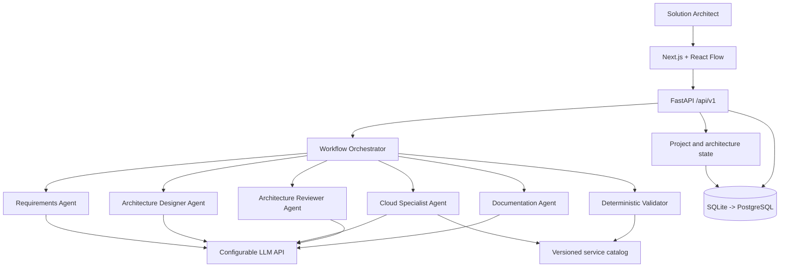

# ArchPilot — Multi-Agent AI Solution Architecture Workbench

**CodeBuddy Development Blueprint | Version 1.1 | 11 November 2026**  
**Planned duration:** 16 weeks (3–4 months, part-time, approximately 8–12 hours/week)  
**Target:** A demonstrable, technically credible intermediate-to-advanced solo portfolio project for AI Solutions Engineering / Cloud Solution Architecture.

> **Instructions to CodeBuddy:** Treat this file as the source-of-truth project brief and implementation roadmap. **Do not implement the entire project in one pass.** Begin with **Phase 0**, then implement one phase at a time, run its tests, report the changes and limitations, and obtain a new instruction before proceeding. If you encounter a design ambiguity, choose the simplest reasonable option that preserves the data contracts in this document, record the decision, and continue. Do not silently replace the core architecture or add unrelated functionality.

---

## 1. Executive summary

### 1.1 What are we building?

**ArchPilot** is a web application for Solution Architects and AI Solutions Engineers to turn a customer's natural-language business requirements into a **structured, editable, reviewable cloud architecture**.

It uses a **controlled multi-agent workflow** to:

1. Analyze the customer brief and distinguish stated requirements from assumptions and unknowns.
2. Conduct **interactive, adaptive requirements discovery**: prioritize questions the Solution Architect should ask, explain why they matter, record answers, and re-evaluate gaps before proceeding.
3. Decompose requirements into reusable **technical capabilities**, rather than matching a prewritten use-case template.
4. Compose a **provider-neutral logical architecture graph** (components and data-flow connections).
5. Map logical capabilities to concrete supported cloud services, backed by a **curated service catalog**.
6. Run **deterministic technical checks** and an independent AI design review.
7. Present a visual architecture editor, show why each component is needed, and track what changes when requirements or architecture elements change.
8. Generate a reviewable proposal/architecture decision record from the approved design.

**Key differentiation from ChatGPT/Claude alone:** Persisted machine-readable design, requirement-to-component traceability, reproducible validation, controlled revision workflows, version/change-impact analysis, and transparent agent outputs. The project is **not** primarily a chatbot or an automatic diagram generator.

### 1.2 Core user journey

```text
Create project
  -> Enter business brief
  -> Requirements Analyst extracts facts, assumptions, prioritized questions
  -> Interactive discovery rounds: SA answers / marks unknown / defers / asks why
  -> Requirements Analyst updates spec and asks only new high-value follow-ups
  -> SA explicitly approves spec, or accepts provisional assumptions with a recorded warning
  -> Architecture Designer proposes logical components + edges
  -> Cloud Specialist maps components to supported services
  -> Rule engine validates the resulting graph and mappings
  -> Architecture Reviewer reports residual risks and trade-offs
  -> Human edits, revalidates, and approves a specific version
  -> Documentation Specialist generates the proposal
  -> Later requirement changes trigger versioned impact analysis
```

### 1.3 What is explicitly out of scope for V1?

- Automatically deploying customer architectures or generating production-ready Terraform.
- Guaranteeing security, compliance, performance, availability, or exact monthly cost.
- Autonomous infrastructure modifications, unrestricted shell execution, or external account access.
- Comprehensive AWS/Azure/GCP/Tencent Cloud coverage; **start with one cloud provider and a small catalog**.
- Handling confidential Tencent/customer data without authorization. **Only public or synthetic customer briefs** in development and portfolio demonstrations.
- Building a general-purpose coding agent, advanced real-time collaboration, billing system, or enterprise IAM.
- Overengineering with Kubernetes or microservices solely for appearance.

### 1.4 Definition of success

A user can enter an **unseen, reasonably scoped cloud application brief**, inspect requirements and open questions, generate a meaningful architecture composed from supported building blocks, see accurate known validation failures, edit the diagram, compare versions/impacts, and export an intelligible technical proposal. Show evidence from evaluation rather than claiming AI correctness.

---

## 2. Architecture and technology decisions

### 2.1 Recommended stack

| Layer | Suggested implementation | Why |
|---|---|---|
| Frontend | Next.js + TypeScript + Tailwind CSS | Interactive web app and typed API consumption |
| Architecture editor | React Flow (`@xyflow/react`) | Nodes, edges, dragging, connecting, zoom, custom node UI |
| Backend | Python 3.11+ + FastAPI | REST API, AI integration, modular backend |
| Data schemas | Pydantic | Validated structured contracts for agents/APIs |
| Workflow orchestration | Start with plain Python coordinator; introduce LangGraph when branching/persistence is needed | Avoid premature orchestration complexity |
| AI provider | One configurable LLM API with structured output support | Make agents swappable and testable |
| Persistence | SQLite for first local prototype, PostgreSQL by production-like V1 | Lower startup friction, credible persistent app later |
| DB layer/migrations | SQLAlchemy + Alembic | Explicit schema changes and versioned data |
| Testing | pytest + FastAPI TestClient; frontend Vitest/Playwright as appropriate | Deterministic tests and end-to-end checks |
| Deployment | Docker + one managed backend host and frontend host, or a simple VM | Deployable portfolio without unnecessary distributed systems |

**Rule:** Don't force LangGraph, Redis, queues, observability infrastructure, or paid cloud services into Phase 0. Introduce only when needed.

### 2.2 High-level components



A **modular monolith** is preferred. Each module has clear responsibilities and contracts, but all backend modules can run in the same process for V1.

### 2.3 Responsibility boundaries

**Use AI for:** understanding ambiguous language, capability decomposition, proposing graph structures, comparing technical options, explaining risk and trade-offs, writing human-readable documentation.

**Use deterministic Python for:** schema validation, unique IDs, edge references, capability coverage, allow/deny constraints, approved catalog lookups, rule execution, arithmetic, version diffs, audit records, JSON export.

**Use a human for:** confirming unclear requirements, accepting assumptions, deciding trade-offs, approving a version for export.

Never represent an LLM's guess as a verified cloud capability, price, compliance outcome, or deployed system.

---

## 3. Agent design and orchestration

### 3.1 The five agents (each owns one primary task)

| Agent | Job | Inputs | Structured output | Tools / boundaries |
|---|---|---|---|---|
| **Requirements Analyst** | Extract stated requirements, assumptions, constraints, prioritize clarifying questions, and conduct adaptive discovery rounds | Original brief + clarifications | `RequirementsSpec` | Must preserve evidence and never silently invent hard requirements |
| **Architecture Designer** | Construct a **logical**, provider-neutral system graph | Approved/provisional requirements + capability vocabulary | `ArchitectureGraph` | Only supported capability types; edges must be explicit |
| **Cloud Service Specialist** | Map logical components to actual supported services | Logical graph + region/preferences + catalog | `ServiceMapping` | Choose only catalog entries; missing fit must be an explicit gap |
| **Architecture Reviewer** | Independently assess weaknesses and explain validation findings | Requirements + graph + mapping + deterministic findings | `ReviewReport` | Cannot mark a failed hard rule as passed; findings are advisory unless proven |
| **Documentation Specialist** | Turn an approved design into a readable customer-facing proposal | Approved snapshot + decisions + assumptions | `SolutionProposal` | Cannot create new technical facts or silently modify the approved architecture |

**Not agents:** deterministic validator, cost calculator, diagram renderer, database persistence, version comparison. These should be ordinary code/services.

### 3.2 Execution model

Initially implement a sequential orchestrator:

```text
requirements_agent
  -> human clarification checkpoint (when required)
  -> architecture_designer
  -> cloud_service_specialist
  -> deterministic_validator
  -> architecture_reviewer
  -> human architecture approval
  -> documentation_agent
```

- Use **typed outputs**, not freeform text parsing.
- Save the original brief and each agent's result independently.
- The orchestrator owns canonical state; agents return candidate artifacts, not direct DB mutations.
- Allow at most **two automatic architecture revision attempts** after deterministic failures. If issues remain, surface them instead of claiming success.
- A new requirement or component edit invalidates affected review/cost statuses; revalidation is required.
- Never create infinite agent-to-agent conversations.
- Trace calls with role, timestamps, model name, prompt/version identifier, inputs' artifact IDs, output artifact IDs, errors, latency, and token usage if available. Do **not** log raw secrets or sensitive customer data.
- For a prototype, synchronous execution is acceptable; later consider persisted jobs/checkpoints for long calls.

### 3.3 When to introduce LangGraph

Use simple Python functions first. In Phase 5, consider LangGraph for explicit state transitions, pauses for human confirmation, retries, and persisted execution. If the existing orchestrator remains clear and sufficient, keeping it is acceptable. **Do not introduce a framework purely to claim a multi-agent project.**

### 3.3 Mandatory consultative discovery workflow (first-class feature)

This is a **core product capability**, not a one-time prompt that prints questions. ArchPilot should actively help a Solution Architect prepare for customer discovery calls and progressively refine a specification. It **does not communicate with customers directly** for V1; the Solutions Architect asks the customer and records answers in ArchPilot.

**Required behaviors:**

1. **Initial assessment:** On brief submission, classify stated facts, inferred capabilities, assumptions, unknowns, contradictions, and possible risks. Preserve an evidence pointer/quote for each stated fact.
2. **Prioritized questions:** Generate up to **3–5 high-impact questions per round**; prioritize blockers for architecture design, data residency/security, scale/peak traffic, integration boundaries, latency/availability, and budget as relevant to this specific customer. Do not dump a generic checklist. Never demand information that is clearly irrelevant.
3. **Explain why:** Each question includes (a) why it matters, (b) which architectural choices depend on it, (c) who should answer it (customer / SA / security team), (d) priority, and (e) whether it blocks **final approval**, not necessarily exploration.
4. **Capture answers:** SA can record `answered`, `unknown`, `deferred`, or `not_applicable`, plus optional evidence/source, author, and timestamp. Allow an explicit `assumption_accepted` state with rationale and visible risk; do not silently treat unanswered information as confirmed.
5. **Re-analysis:** After each answer round, update a **new requirements-spec version**, check for contradictions, mark answered questions closed, re-rank open questions, and ask follow-ups based on new information. For instance, "on-prem only" changes which hosting/model questions matter. Do not repeat previously answered questions unless conflicting evidence requires reconfirmation.
6. **Discovery gate:** The SA chooses `continue_discovery`, `generate_provisional_architecture`, or `approve_requirements`. Blocking unknowns must prevent claiming that a design is finalized or requirements are satisfied. A provisional **draft architecture** may be generated with prominently labeled assumptions and warnings if the user chooses to proceed. An architecture must never be automatically approved.
7. **Handoff:** Pass the confirmed requirements, accepted assumptions, outstanding questions, and traceability IDs to the Architecture Designer. Keep the original brief and all Q&A rounds for auditing and later change-impact analysis.
8. **Avoid loops and needless cost:** Limit rounds and questions per round, deduplicate semantically equivalent questions, and let users stop. A new question requires a meaningful information gap or contradiction. Provide a concise discovery summary after each round.

**Suggested status model:** `draft -> needs_clarification -> partially_defined -> ready_for_design -> provisional_design -> awaiting_approval`, with explicit user decisions controlling transitions. These are discovery/workflow states; do not automatically use them as a substitute for project or architecture version statuses.

**Question example** (illustrative data contract; finalize Pydantic schema during Phase 2):

```json
{
  "id": "Q-001",
  "question": "Where may customer data be processed and stored?",
  "reason": "Affects model hosting, cloud region, storage and logs",
  "impacts": ["model_deployment", "storage", "logging"],
  "asked_to": "customer",
  "priority": "critical",
  "blocks_final_approval": true,
  "status": "unanswered",
  "answer": null,
  "source": null
}
```

**UX:** Show a two-column **Discovery Workspace**: left side has original customer brief and facts/assumptions, right side has prioritized Q&A cards and a progress/readiness summary. The user can fill answers individually or in batches, mark a question unknown, and click **Re-analyze answers**. Display what changed and what still needs customer clarification. "Ready" is defined by your explicit completeness policy; it is not an objective claim of architectural correctness.

**Acceptance scenario:** Given "10,000 conversations/day, bilingual, sensitive data, limited budget", ArchPilot asks for numeric budget, processing/storage region, peak volume, and the role of the assistant. After the SA answers "EU-only, €1,500/month, FAQ-only", it updates the requirements, stops asking those questions, raises region and budget constraints for design, and asks additional questions only if they materially affect architecture. If the SA leaves peak concurrency unanswered, the workflow can offer a provisional design but must mark sizing and SLA estimates as unverified.

**Baseline comparison:** For evaluation, run the same briefs through a one-shot LLM requirement extractor. Measure discovery recall for known missing requirements, relevance of questions (human review), avoided repeat questions, and whether contradictory answers are correctly surfaced.

---

---

## 4. Core data contracts (design before writing the agents)

These are **logical contracts**, not necessarily final code. Implement real Pydantic schemas, validate them at runtime, and version the schema (`schema_version`). Use stable IDs, never rely on display names as identifiers.

### 4.1 Requirements

```json
{
  "schema_version": "1.0",
  "brief_id": "brief-001",
  "requirements": [
    {
      "id": "REQ-001",
      "type": "functional",
      "statement": "Answer questions using internal documents",
      "source": "Original customer brief",
      "status": "stated",
      "priority": "must",
      "capabilities": ["document_retrieval", "llm_inference"]
    },
    {
      "id": "REQ-002",
      "type": "non_functional",
      "statement": "Protect sensitive customer data",
      "source": "Original customer brief",
      "status": "stated",
      "priority": "must",
      "capabilities": ["authentication", "access_control"]
    }
  ],
  "assumptions": [
    {"id": "ASM-001", "statement": "A managed cloud LLM is permissible", "accepted": false}
  ],
  "questions": [
    {
      "id": "Q-001",
      "question": "Which countries or regions may process customer data?",
      "blocking": true,
      "status": "unanswered"
    }
  ]
}
```

**Semantics:** `stated` means explicitly in the brief; `assumed` means proposed and awaiting confirmation; `confirmed` means a human affirmed it. Unknowns are **questions**, not fabricated requirements. Capability tags are inferred and should be traceable to explicit requirements.

### 4.2 Logical architecture

```json
{
  "schema_version": "1.0",
  "architecture_id": "arch-001",
  "version": 1,
  "nodes": [
    {
      "id": "node-api",
      "capability": "api_backend",
      "label": "Application API",
      "requirement_ids": ["REQ-001"]
    },
    {
      "id": "node-retrieval",
      "capability": "document_retrieval",
      "label": "Document retrieval",
      "requirement_ids": ["REQ-001"]
    },
    {
      "id": "node-llm",
      "capability": "llm_inference",
      "label": "LLM inference",
      "requirement_ids": ["REQ-001"]
    }
  ],
  "edges": [
    {"id": "edge-1", "source": "node-api", "target": "node-retrieval", "kind": "request"},
    {"id": "edge-2", "source": "node-api", "target": "node-llm", "kind": "request"}
  ],
  "unresolved_requirement_ids": ["REQ-002"]
}
```

The graph is **the authoritative design artifact**. React Flow positions, zoom, and styling are UI metadata, not business logic. A capability present in the graph does **not** prove that its security, performance, or business requirements have been met.

### 4.3 Cloud service catalog and mapping

```json
{
  "catalog_version": "2026-11-demo-v1",
  "service_id": "aws-sqs",
  "provider": "aws",
  "display_name": "Amazon SQS",
  "capabilities": ["message_queue"],
  "constraints": ["requires_consumer", "at_least_once_processing_possible"],
  "region_support": "verify_from_source",
  "documentation_url": "https://docs.aws.amazon.com/AWSSimpleQueueService/latest/SQSDeveloperGuide/welcome.html"
}
```

Mapping: `node_id -> service_id | null`, plus rationale, supporting catalog version, warnings, and unsupported conditions. The catalog cannot claim real-time region/price facts without a checked source and timestamp. Begin with a small hand-curated catalog and explicit unknowns; don't scrape or hallucinate values.

### 4.4 Validation findings

```json
{
  "architecture_id": "arch-001",
  "architecture_version": 1,
  "passed_defined_checks": false,
  "issues": [
    {
      "rule_id": "ARCH-003",
      "severity": "error",
      "message": "No component satisfies the document retrieval capability",
      "affected_node_ids": [],
      "affected_requirement_ids": ["REQ-001"],
      "evidence": "REQ-001 requires document_retrieval",
      "suggestion": "Add an appropriate retrieval component"
    }
  ]
}
```

Severity: `error`, `warning`, `info`. Be careful: `passed_defined_checks=true` does **not** imply a design is safe, correct, or deployable.

### 4.5 Version/change tracking

Persist project ID, architecture version ID, parent version ID, creation timestamp, author/origin (`human`, `agent`), changed requirement IDs, changed node/edge IDs, validation status, approval status, and affected artifacts. **Never silently overwrite an approved version.**

### 4.6 Agent contracts and failures

Every agent should return either a schema-valid artifact or a typed failure such as `MODEL_TIMEOUT`, `INVALID_STRUCTURED_OUTPUT`, `UNSUPPORTED_CAPABILITY`, or `CATALOG_NO_MATCH`. Use bounded retries and show partial findings when the system cannot finish. Do not output polished fake results to conceal failures.

---

## 5. Proposed repository layout

```text
archpilot/
├── README.md
├── .env.example                  # Variable names only, no secrets
├── .gitignore
├── docker-compose.yml           # Add only when necessary
├── docs/
│   ├── architecture.md
│   ├── decisions/
│   └── evaluation.md
├── examples/
│   ├── briefs/
│   ├── architectures/
│   └── catalog/
├── backend/
│   ├── pyproject.toml
│   ├── app/
│   │   ├── main.py
│   │   ├── api/                  # APIRouter endpoint modules
│   │   ├── schemas/              # Pydantic contracts
│   │   ├── domain/               # Graph, requirements, version logic
│   │   ├── agents/               # Each agent owns one responsibility
│   │   ├── orchestration/        # Workflow state, retries, checkpoints
│   │   ├── catalog/              # Curated capabilities/service data
│   │   ├── validators/           # Deterministic rules
│   │   ├── repositories/         # DB abstraction/persistence
│   │   ├── services/             # Application use cases
│   │   └── config.py
│   └── tests/
├── frontend/
│   ├── package.json
│   ├── app/
│   ├── components/
│   │   ├── requirements/
│   │   ├── architecture/
│   │   ├── validation/
│   │   └── agents/
│   ├── lib/                      # Typed API client and adapters
│   └── tests/
└── scripts/
```

This is a **target structure**, not a command to create dozens of empty files immediately. Grow the repository with implemented functionality.

---

## 6. Development phases (16-week reference plan)

### Phase 0 — Project foundation and boundaries (Week 1)

**What this phase is about:** Establish a maintainable starting point, define the minimum real user problem, and agree on data contracts before involving an LLM.

**What it does:** Creates a runnable backend, an initial test harness, example customer briefs, and documented engineering choices.

**How to implement:**

1. Initialize Git and folders; add `.gitignore`, `README.md`, `.env.example`.
2. Install Python 3.11+, create virtual environment; choose a dependency manager (pip/uv/Poetry) and stick with it.
3. Create FastAPI app, `/api/v1/health`, pytest setup, formatting/linting (Ruff recommended).
4. Write Pydantic types for requirement, question, component, edge, graph, and finding.
5. Define a **small capability vocabulary**: e.g. `api_backend`, `authentication`, `access_control`, `object_storage`, `database`, `message_queue`, `background_worker`, `llm_inference`, `document_retrieval`, `notification`, `observability`.
6. Add three synthetic briefs: customer-support AI, document-processing workflow, and media-moderation pipeline. These are **tests**, not hardcoded end-to-end templates.
7. Create `docs/architecture.md` explaining the core modular monolith and source-of-truth graph.

**Done when:** Backend runs, `/health` succeeds, schemas reject malformed payloads, tests run locally, and one example architecture JSON validates against the Pydantic structure.

**Do not do yet:** Agent orchestration, database migrations, cloud deployment, complex frontend.

### Phase 1 — Architecture graph and deterministic validator (Weeks 2–3)

**What this phase is about:** Build what generic LLM prompting lacks: an executable architecture data model and reproducible checks.

**What it does:** Validates graph integrity, requirement coverage, and basic component constraints independently of any AI.

**How to implement:**

1. Implement `ArchitectureGraph` with typed nodes and directed edges.
2. Implement a rule interface: `check(context) -> list[ValidationIssue]`, with rule ID, severity, affected IDs, evidence, and recommendation.
3. Initial rules:
   - `ARCH-001` duplicate node/edge IDs.
   - `ARCH-002` dangling connections to nonexistent nodes.
   - `ARCH-003` declared must-have capability not represented by a graph node.
   - `ARCH-004` invalid requirement IDs referenced by nodes.
   - `ARCH-005` message queue without a designated consumer/worker (use catalog semantics; warning if uncertain).
   - `ARCH-006` unknown/unaccepted critical assumptions surfaced as unresolved (not an automatic technical failure).
4. Return findings sorted by severity; distinguish **schema error**, **rule violation**, and **unanswered requirement**.
5. Expose `POST /api/v1/architectures/validate` with request/response models.
6. Write positive and negative unit tests for every rule. Include deliberate edge cases, not only happy paths.
7. Add an example invalid architecture that produces at least two meaningful findings.

**Done when:** Running the same validator against the same graph always returns the same findings; failing tests cover duplicate/dangling IDs and missing capabilities; `/docs` shows the endpoint; no LLM API is required.

**Watch out:** Capability presence alone is not proof of NFR compliance. Do not claim high availability because a load-balancer node exists.

### Phase 2 — Requirements Analyst agent (Weeks 4–5)

**What this phase is about:** Convert a free-text business brief into reliable structured inputs while keeping uncertainties visible.

**What it does:** Extracts stated functional/NFR requirements, identifies proposed capabilities, classifies assumptions, prioritizes the questions an SA has not asked, and conducts adaptive question-and-answer discovery rounds. This is a **required user-facing feature**, not merely one LLM response.

**How to implement:**

1. Create a provider-agnostic `LLMClient` interface, implemented first with one supported provider.
2. Build an agent prompt that returns **exactly** the `RequirementsSpec` schema using structured output/function calling as supported by the provider.
3. Require every stated requirement to include a short evidence excerpt or pointer to the brief. Reject unsupported manufactured facts.
4. Separate explicit facts from proposed assumptions; don't convert unknown budget, region, peak RPS, or data retention into fake requirements.
5. Use a controlled capability vocabulary; return `unmapped` when nothing matches.
6. Add an endpoint such as `POST /api/v1/requirements/extract` for brief -> structured spec.
7. Define typed `ClarifyingQuestion` and `DiscoveryAnswer` models, including priority, rationale, affected design decisions, intended respondent, status, and evidence/source.
8. Implement `POST /api/v1/projects/{project_id}/discovery/answers` to capture answers and `POST /api/v1/projects/{project_id}/discovery/reanalyze` to produce a **new** spec version and an updated, deduplicated question set.
9. Implement question ranking, answer-state handling (`answered`, `unknown`, `deferred`, `not_applicable`), contradiction checks, and a `ready_for_design` decision with transparent reasons. Ask no more than 3–5 targeted questions per round.
10. Implement explicit SA actions: continue discovery, approve requirements, or proceed with a provisional architecture (assumptions and unresolved blockers recorded and prominently visible).
11. Add mock LLM responses for offline tests, plus optional live integration tests behind an API-key requirement.
12. Add a basic Q&A interface (or Swagger workflow initially) that supports multiple question/answer/re-analysis rounds; show why each question matters.

**Done when:** For the sample 10,000-conversations/day brief, the system extracts known requirements, prioritizes actionable questions for the SA, accepts answers, updates the spec and next questions without repeating closed ones, and never invents SLAs. It distinguishes provisional design from approved requirements. Malformed model outputs fail gracefully.

### Phase 3 — Architecture Designer agent (Weeks 6–7)

**What this phase is about:** Generate **new compositions of supported building blocks**, not select predefined application-specific templates.

**What it does:** Converts requirements/capabilities into a provider-neutral graph with explicit components, edges, and requirement mapping.

**How to implement:**

1. Define the supported component and edge-type vocabulary. Start with roughly 10–15 capabilities, expand only as validated needs arise.
2. Prompt the Architecture Designer with `RequirementsSpec`, vocabulary definitions, and a few general constraints; **do not pass a completed architecture per use case**.
3. Generate valid `ArchitectureGraph` structured output and store the unmodified candidate before repairs.
4. Run the Phase 1 validator. If errors are found, pass issue IDs/details back for at most two correction attempts.
5. Preserve unresolved requirements; never invent the missing cloud region or compliance policy.
6. Trace each node to a requirement or a documented cross-cutting architecture rationale.
7. Provide `POST /api/v1/architectures/generate` and a read endpoint for generated output.
8. Test with a held-out brief such as invoice extraction + human review + notifications, which was not used as a worked example in prompts.

**Done when:** Two materially different briefs produce structurally different graphs, all nodes/edges validate structurally, and the agent can explicitly report unsupported capabilities rather than fabricating nodes.

**Important:** Keep the logical architecture independent of vendor services to reduce provider lock-in.

### Phase 4 — Cloud Specialist and service catalog (Weeks 8–9)

**What this phase is about:** Convert abstract capabilities into grounded product/service choices.

**What it does:** Maps graph nodes to cloud services, explains the trade-offs, and identifies mismatches or unknowns.

**How to implement:**

1. Start with **one provider: AWS** (choice can be changed before implementation if there is a strong reason). Build a small local JSON/YAML catalog (approximately 15–25 common services/categories), with provider ID, capabilities, limitations, dependencies, official doc URL, source-check timestamp, and optional region metadata.
2. Make service catalog queries deterministic. The agent can choose from catalog IDs but cannot invent unsupported service IDs.
3. Create `ServiceMapping` and separate the selection from the logical graph.
4. Validate `service_id` existence and capability fit, and require explicit warnings for incomplete catalog coverage.
5. Use reasoned service explanations referencing catalog facts, not model memory alone.
6. Add optional cost metadata placeholders; **do not output invented prices**.
7. Test valid mapping, invalid service ID, absent region evidence, and no-match behavior.

**Done when:** Every mapped node references a supported catalog item, and the platform visibly states when a component cannot be mapped confidently.

### Phase 5 — Workflow orchestrator and Architecture Reviewer (Weeks 10–11)

**What this phase is about:** Turn independent agent functions into a controlled **multi-agent** process with review and checkpoints.

**What it does:** Executes agents in order, manages artifacts and failures, enforces human approval, and provides a trace of what happened.

**How to implement:**

1. Define a typed `ProjectRunState` containing project ID, source brief, artifact/version IDs, current step, validation, errors, and revision count.
2. Orchestrate Requirements -> **interactive multi-round discovery checkpoint** -> Design -> Cloud Mapping -> Validator -> Reviewer. Persist Q&A rounds, support pause/resume, and make the SA explicitly choose between further clarification, provisional design with visible uncertainty, or approving requirements.
3. Implement the Reviewer as a **separate LLM role** assessing completeness, privacy, reliability, operational trade-offs, and unverified assumptions. It may suggest changes but **cannot override deterministic validation results**.
4. Add bounded retries/timeouts and a maximum of two architecture repair attempts.
5. Persist step transitions and artifacts; record failures rather than hiding them.
6. Add a `human_review_required` state before documentation generation.
7. Consider LangGraph for shared state, conditional edges, and persisted human interrupts; decide based on implementation complexity.
8. Provide simple run initiation/status endpoints and a machine-readable execution trace.

**Done when:** A workflow can be paused for a clarification, resumed after an answer, produce review findings, survive a failed LLM call without corrupting approved state, and reject unlimited retry loops.

### Phase 6 — Architecture Studio frontend (Weeks 12–13)

**What this phase is about:** Make the design understandable and editable by a human architect.

**What it does:** Shows customer requirements alongside the generated graph and validation/reviewer findings.

**How to implement:**

1. Implement Next.js pages: project overview, **Discovery Workspace (requirements + prioritized questions + answers + readiness)**, architecture studio, and review sidebar.
2. Use React Flow for nodes/edges, minimap/zoom, component property panel, and a simple add/remove/connect workflow.
3. Build an adapter `ArchitectureGraph <-> ReactFlow nodes/edges` with stable IDs. Keep layout coordinates separate from domain graph data.
4. Clicking a node displays mapped service, supporting requirement IDs, reason, warnings, and connected edges.
5. Edits produce a new draft architecture version, run validation, and mark previous reviews as stale.
6. In Discovery Workspace, show "why we ask", question priority, customer vs SA responsibility, open/answered/deferred filters, and a re-analyze action; disable final requirements approval while hard blockers are unaddressed without explicit risk acceptance.
7. Present agent stage progress and failures as truthful statuses, not fake live activity.
8. Use a simple responsive clean UI; prioritize function over elaborate styling.
9. Never allow UI-only state to diverge silently from saved architecture state.

**Done when:** User can conduct at least two adaptive requirements discovery rounds, see resolved/unresolved questions and assumptions, then generate a candidate, inspect nodes and requirement mappings, modify/add/remove connections, save the version, and see updated validation results.

### Phase 7 — Persistence, versioning, and change-impact analysis (Weeks 14–15)

**What this phase is about:** Deliver the core differentiator versus a chat transcript: trustworthy architecture evolution.

**What it does:** Tracks immutable architecture versions and shows which components/reviews/cost estimates are impacted by requirement or graph changes.

**How to implement:**

1. Introduce persistent database tables for projects, briefs, requirements versions, graph versions, service mapping versions, findings, approval events, and run traces. Use Alembic migrations.
2. Graph versions carry `parent_version_id`; never mutate historical approved snapshots.
3. Implement structural diffs: added/removed/changed nodes, edges, requirement mappings, and service mappings.
4. Build an impact function that traces changed requirements -> linked nodes -> connected nodes -> service mappings and review/cost artifacts. Label *directly impacted* vs *potentially impacted*. Don't pretend a dependency scan proves complete business impact.
5. Add conflict handling (e.g., HTTP 409) if two edits target an out-of-date version.
6. Add endpoints to list versions, compare two snapshots, and run change-impact analysis.
7. UI shows changes, affected components, and stale assessments.
8. Test: changing data residency flags mappings requiring a region recheck; removing a retrieval node invalidates the requirement coverage; rollback creates a new version from an old snapshot.

**Done when:** A user can revisit previous versions, see a meaningful diff, and explain why a requirement change caused a particular design decision to need review.

### Phase 8 — Documentation, evaluation, and deployment (Week 16)

**What this phase is about:** Package the project as a demonstrable, honest engineering portfolio artifact.

**What it does:** Generates a customer-ready draft proposal, deploys the product, and quantifies whether multi-agent design adds value.

**How to implement:**

1. Documentation Agent consumes the **human-approved immutable snapshot**, not loosely related conversation history.
2. Export Markdown containing: customer goal, confirmed requirements, assumptions/questions, diagram, component rationale, validation findings, architecture alternatives, and ADRs. PDF export is optional.
3. If time allows, add **bounded, deterministic** cost estimates for a few selected components, with pricing version/source, dated assumptions, and missing-cost labels. Otherwise defer cost engine rather than inventing totals.
4. Prepare 15–20 synthetic briefs (including unseen cases and contradictory requirements); manually define expected required capabilities and known violations.
5. Compare **single-agent baseline vs controlled multi-agent workflow** on the same inputs: requirement extraction quality, known-rule violations, coverage, architecture review quality, latency, and API expense. Multiple runs are preferable for nondeterministic outputs.
6. Add logging and basic tests, clean error messages, Dockerization, deployment guide, API documentation, architecture diagram, screenshots, and a short demo walkthrough.
7. Deploy only with appropriately secured API secrets, restrictive CORS, authentication or access restrictions for any public instance, and budget/rate limits.

**Done when:** A reviewer can access a demo (or run it locally), reproduce a working example, see measured results and known limitations, and inspect the code and architecture documentation.

**If running behind schedule:** Prioritize Phases 0–6, a minimal persisted version history, and evaluation. Postpone detailed costing, PDF export, multiple providers, and elaborate interface polish.

---

## 7. API contract sketch (finalize and version as phases progress)

All endpoints should use typed request/response models and a versioned prefix `/api/v1`.

| Endpoint | Method | Purpose | Earliest phase |
|---|---|---|---|
| `/health` | GET | Liveness | 0 |
| `/architectures/validate` | POST | Validate submitted graph + requirements | 1 |
| `/requirements/extract` | POST | Extract structured requirements from brief | 2 |
| `/projects/{project_id}/discovery/questions` | GET | Current prioritized open/answered questions, explanations, and readiness | 2 |
| `/projects/{project_id}/discovery/answers` | POST | Record one or more SA/customer responses and their sources | 2 |
| `/projects/{project_id}/discovery/reanalyze` | POST | Revise spec and generate context-sensitive follow-ups | 2 |
| `/projects/{project_id}/discovery/decision` | POST | Continue discovery / approve requirements / request provisional design | 2–5 |
| `/architectures/generate` | POST | Generate logical architecture from spec | 3 |
| `/catalog/services` | GET | List supported service entries | 4 |
| `/architectures/map-services` | POST | Map logical nodes to supported cloud services | 4 |
| `/projects` | POST/GET | Create/list saved projects | 5–7 |
| `/projects/{project_id}/runs` | POST | Start multi-agent workflow | 5 |
| `/runs/{run_id}` | GET | Workflow progress and agent step history | 5 |
| `/projects/{project_id}/architectures` | GET/POST | List/create graph versions | 6–7 |
| `/architectures/{architecture_id}/impact` | POST | Compare impacts against proposed changes | 7 |
| `/architectures/{architecture_id}/approve` | POST | Human approval of a specific version | 7 |
| `/architectures/{architecture_id}/proposal` | POST | Generate proposal from approved snapshot | 8 |

Use sensible IDs and status codes: `400/422` for invalid data, `404` unknown objects, `409` version conflict, `502/503` transient upstream LLM failure. Add authentication before exposing user projects publicly.

---

## 8. Initial test cases and evaluation strategy

### 8.1 Representative synthetic customer briefs

**Brief A — RAG customer support**

> We need an AI customer support system for 10,000 conversations per day. It should answer questions from internal documents, support English and Chinese, protect sensitive customer data, and stay within a limited budget.

Expected discovery: language support, document-grounded answers, traffic volume, sensitive data. **Unknown:** numeric budget, peak concurrency, service region, retention, SLA. Architecture may propose retrieval + inference + app API + access control; those are candidates to validate, not guaranteed solutions.

**Brief B — Media moderation**

> Users upload short videos and images. The system should classify content, queue expensive processing, save moderation decisions, and allow a human to review uncertain cases.

Expected capabilities: upload/API, object storage, asynchronous queue, consumers/workers, moderation inference, persistence, review UI. Need unanswered questions about throughput, policy definition, retention, and latency.

**Brief C — Document automation**

> Employees upload invoices. AI should extract the supplier name and total, store records in a database, and notify a reviewer when the extraction is uncertain.

Expected capabilities: file ingestion, extraction inference, structured persistence, confidence/review routing, notification. This should **not** depend on a hardcoded "invoice processing architecture" template.

**Brief D — Conflicting constraints**

> We require EU-only storage and processing and 99.99% uptime, but we insist on a service whose availability in the selected EU region has not been established.

Expected behavior: flag incompatibility/unknown evidence. Do not invent service availability or assert the architecture satisfies SLA.

### 8.2 Automated test coverage

- Pydantic: missing fields, invalid enum values, duplicate graph IDs, malformed structured agent outputs.
- Validator: all rule success/failure cases, stable issue IDs, missing required capabilities, dangling references, unsupported catalog ID.
- Requirements discovery: question relevance and priority, multiple answer rounds, no repeat questions, contradictory answers, explicit unknown/deferred handling, provisional-design warnings and blocked approval.
- Agent orchestration: timeouts, invalid outputs, API failures, retry budget exhaustion, human clarification/approval interrupt, stale artifacts.
- Persistence/versioning: immutable approved snapshots, diff correctness, rollback-by-new-version, conflict response.
- Frontend: graph rendering, stable ID mapping, edit/save/reload, validation panel.
- Security: API key not exposed to browser, logs redact secrets, user brief treated as untrusted content, untrusted documentation cannot override agent instructions.

### 8.3 Portfolio comparison

Build the **single-agent baseline** as one prompt that receives the same brief/catalog and returns the same expected graph schema. Compare fairly against multi-agent using identical test cases, validation rules, and as similar model/pricing settings as feasible. Do not assume multi-agent is superior; measure quality, expense, and latency.

Suggested reported metrics: requirements precision/recall against a small reviewed reference set, fraction of graph outputs passing defined checks, severe known-rule violations per design, issue detection precision/recall, mean latency, and estimated API cost/run. A human reviewer should assess ambiguous architectural quality separately.

---

## 9. Coding conventions and implementation policies for CodeBuddy

1. **Incremental commits:** implement one phase at a time and stop at its acceptance criteria.
2. **Smallest useful implementation:** avoid speculative abstractions until a second implementation needs them.
3. **Tests required:** add or update tests with each behavior change; don't declare completion while relevant tests fail.
4. **Typed interfaces:** use Pydantic response/request models, explicit types, structured error codes, and a typed frontend API client.
5. **Deterministic domain logic:** keep validation, graph diff, service lookup, and calculations outside of prompts.
6. **LLM flexibility:** keep provider credentials/config in environment variables. Never commit secrets, hard-code API keys, or call models from the browser.
7. **Safe inputs:** customer briefs, uploaded text, and retrieved provider documents are untrusted **data**, not instructions to execute. Do not execute generated code or cloud changes.
8. **Data provenance:** track which human input or catalog source supports each factual claim.
9. **Clear status labels:** distinguish `draft`, `needs_clarification`, `generated`, `validation_failed`, `review_required`, `approved`, `stale`, and `exported`.
10. **Fail honestly:** when a feature is unavailable, show a meaningful warning; don't display fabricated costs, fake model calls, or default "all checks passed" banners.
11. **Avoid scope creep:** prioritize architecture correctness and change traceability ahead of fancy UI themes or extra agents.
12. **Document decisions:** record material trade-offs as short ADRs in `docs/decisions/`.
13. **Avoid internal Tencent material:** all example data must be synthetic or permitted public content. No company-specific credentials, system diagrams, metrics, or customer data in a public repo.
14. **Request review at milestones:** at the end of each phase provide what changed, how to run, tests run/results, known issues, and exactly what Phase N+1 will add.

---

## 10. Immediate first development session — exactly what CodeBuddy should do

**Scope: Phase 0 only.** Do not write all five agents, the React Flow application, or the cloud catalog in this first session.

1. Inspect the repository (if it already exists) before modifying files.
2. Initialize backend packaging and FastAPI app with `GET /api/v1/health`.
3. Implement initial Pydantic contracts: `Requirement`, `ClarifyingQuestion`, `ArchitectureNode`, `ArchitectureEdge`, `ArchitectureGraph`, `ValidationIssue`.
4. Create `examples/briefs/` with at least three **synthetic** texts and one representative JSON architecture. Include a brief with missing budget, region, and peak traffic to later exercise the discovery loop.
5. Implement tests: app health response; valid graph parsing; invalid graph payload rejected with 422. **Cross-node validations may wait for Phase 1.**
6. Add a simple README containing prerequisites, setup, local run/test commands, scope, and roadmap.
7. Ensure `pytest` passes and API docs work at `/docs`.
8. End with a concise change summary and clear next-step handoff for Phase 1.

### Expected first-session result

```text
archpilot/
├── README.md
├── .gitignore
├── .env.example
├── backend/
│   ├── pyproject.toml
│   ├── app/
│   │   ├── main.py
│   │   └── schemas/
│   │       └── architecture.py
│   └── tests/
│       ├── test_health.py
│       └── test_schemas.py
├── examples/
│   ├── briefs/
│   └── architectures/
└── docs/
    └── architecture.md
```

### First message to CodeBuddy (copy/paste)

> Read `ArchPilot_CodeBuddy_Development_Blueprint.md` in full. This is a 16-week phased, multi-agent AI Solution Architecture Workbench project. Start with **Phase 0 only**. Before coding, summarize the intended repository structure and the minimum Pydantic contracts. Then implement the minimal FastAPI backend, example synthetic briefs, basic tests, and README. Run the tests and report results, file changes, assumptions, and any blockers. Do not jump into agents, frontend, or cloud services until I explicitly ask you to start the next phase.

---

## 11. Reference documentation

Use current official docs before implementing framework-specific code; API behavior and library versions can change.

- FastAPI multi-file backend structure: https://fastapi.tiangolo.com/tutorial/bigger-applications/
- Pydantic schema/models: https://docs.pydantic.dev/latest/concepts/models/
- React Flow quick start (`@xyflow/react`): https://reactflow.dev/learn
- React Flow with TypeScript: https://reactflow.dev/learn/advanced-use/typescript
- LangGraph overview/stateful orchestration: https://docs.langchain.com/oss/python/langgraph/overview
- LangGraph human-in-the-loop interrupts: https://docs.langchain.com/oss/python/langgraph/interrupts
- AWS reference architecture guidance: https://docs.aws.amazon.com/wellarchitected/latest/framework/welcome.html

---

## 12. Final guardrail: what makes this project worth building?

Do **not** optimize solely for a polished AI-generated diagram. The portfolio differentiator is the integrated engineering system:

- **Traceable requirements:** understand exactly why a component was included.
- **Architecture as structured data:** designs are machine-readable, editable, versioned artifacts.
- **Deterministic checks:** catch specific reproducible design errors.
- **Multi-agent responsibilities:** each agent has a defined role, tool boundary, and typed output.
- **Human-in-the-loop:** ambiguous inputs and trade-offs are reviewed before approval.
- **Change-impact analysis:** identify what needs to be rechecked after requirements change.
- **Evaluation:** prove whether the controlled system performs better than simply prompting a general LLM.

**First milestone:** a running FastAPI project with typed architecture models and tests. **First meaningful product demo:** a business brief -> structured requirements -> graph proposal -> deterministic validation -> visible, editable architecture. **Final milestone:** a traceable, versioned, human-reviewed, evaluated multi-agent architecture workbench.
